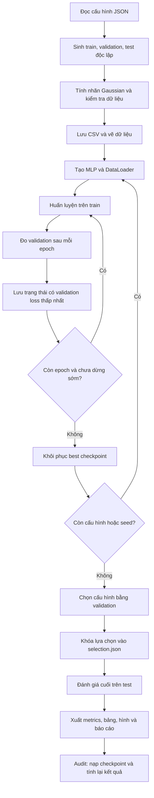
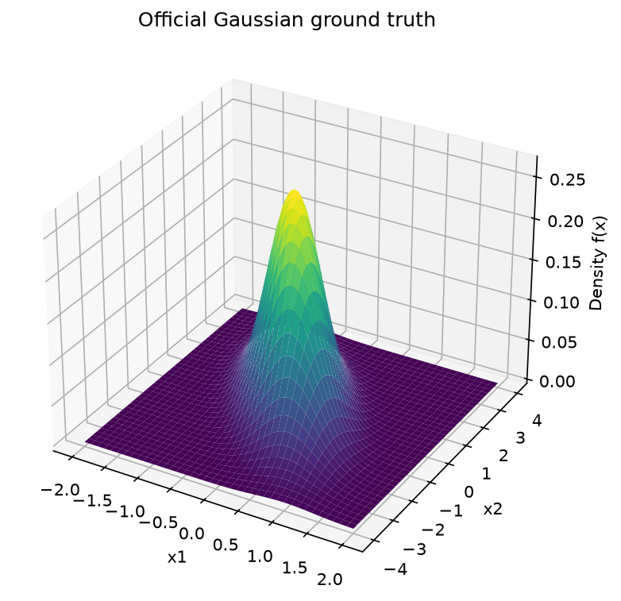
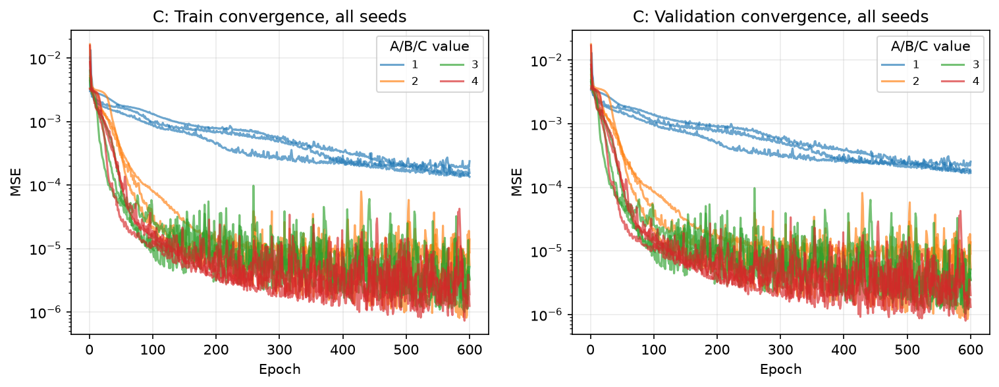
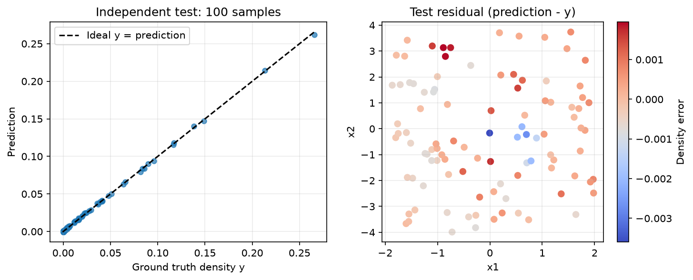
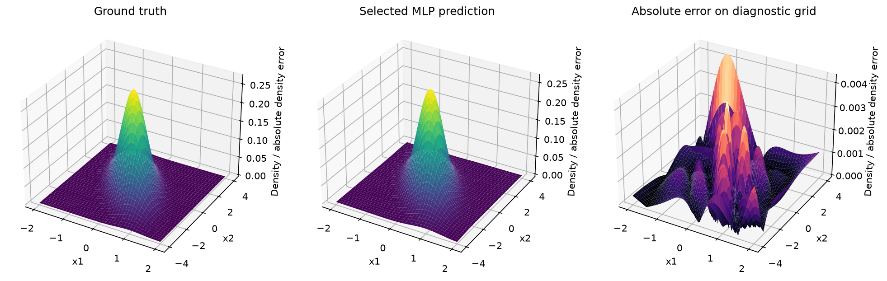

# Hiểu BTL01 từ đầu đến cuối: xấp xỉ Gaussian 2D bằng MLP

Tài liệu này dành cho người mới học Machine Learning và PyTorch. Mục tiêu là giúp bạn hiểu **bài tập đang giải quyết vấn đề gì, từng thành phần dùng để làm gì, vì sao cần nó và chương trình chạy qua những bước nào**.

Các giải thích bám theo mã nguồn của project. Các ví dụ tính tay được ghi rõ là ví dụ minh họa; phần kết quả thực nghiệm lấy từ CSV đã lưu trong `results/`.

Bạn không cần hiểu hết đạo hàm và đại số ma trận ngay lần đọc đầu. Trước tiên hãy nắm được luồng dữ liệu, rồi quay lại công thức và code.

## Cách đọc tài liệu

| Lượt đọc | Nội dung | Điều cần hiểu |
| --- | --- | --- |
| 1 | Mục 1–7 | Bài toán, dữ liệu, train/validation/test và MLP |
| 2 | Mục 8–14 | Cách mạng dự đoán, tính sai số và học từ sai số |
| 3 | Mục 15–20 | Thực nghiệm, chọn mô hình, đọc kết quả và vai trò từng file |
| 4 | Mục 21–24 | Tự chạy, tự kiểm tra và ôn lại kiến thức |

Tài liệu liên quan:

- [README](../README.md): cài đặt, cấu trúc thư mục và lệnh chạy.
- [Implementation Report](IMPLEMENTATION_REPORT.md): báo cáo kỹ thuật và số liệu chi tiết.
- [Requirement Traceability Matrix](REQUIREMENT_TRACEABILITY.md): đối chiếu yêu cầu đề bài với phần triển khai.
- [Báo cáo học thuật PDF](ACADEMIC_REPORT.pdf): bản trình bày để đọc hoặc nộp bài.

## 1. Bài tập này thực chất muốn làm gì?

Giả sử có một bề mặt giống ngọn đồi. Bạn đứng tại vị trí có hai tọa độ `x1`, `x2` và muốn biết độ cao `y` của bề mặt tại đó.

Trong bài tập:

- `x1`, `x2` là hai số đầu vào.
- Hàm Gaussian 2D là quy tắc cho biết giá trị thật `y` tại vị trí đó.
- Mạng MLP nhận hai số và tạo một dự đoán `ŷ`, đọc là “y mũ”.

Ta muốn:

```text
ŷ = MLP(x1, x2)

ŷ càng gần y = Gaussian(x1, x2) càng tốt.
```

Ví dụ, tại `(0, 0)`, hàm thật cho giá trị khoảng `0.269021`. Mạng chưa học có thể trả về một số rất khác. Sau huấn luyện, ta mong mạng dự đoán gần giá trị thật hơn, kể cả tại những tọa độ chưa dùng để huấn luyện.

Đây là **học có giám sát**: mỗi đầu vào có một đáp án đúng để học. Đây cũng là **bài toán hồi quy**: đầu ra là một giá trị liên tục, thay vì một nhãn như “mèo” hoặc “chó”.

### Vì sao đã có công thức Gaussian mà vẫn cần MLP?

Trong bài tập, Gaussian là một hàm chuẩn để thực hành. Vì biết đáp án đúng, ta dễ sinh dữ liệu và đo chính xác mạng sai bao nhiêu.

Mục tiêu là học quy trình xây dựng, huấn luyện và đánh giá mạng nơ-ron. Với riêng hàm Gaussian đã biết này, tính trực tiếp bằng công thức vẫn là một cách hợp lý; bài tập không chứng minh rằng dùng MLP luôn nhanh hoặc tốt hơn công thức.

Trong nhiều bài toán thực tế, ta chỉ có các cặp đầu vào–kết quả đo, còn công thức liên hệ giữa chúng thì chưa biết. Cách học từ ví dụ ở đây giúp bạn hiểu nền tảng để xử lý những trường hợp đó.

## 2. Nhìn toàn bộ quy trình trước khi đi vào chi tiết



Nếu trình xem Markdown không hiển thị sơ đồ, hãy đọc theo chuỗi:

**Sinh dữ liệu → huấn luyện → kiểm tra validation → giữ mô hình tốt nhất → chọn cấu hình → đánh giá test → báo cáo → kiểm chứng.**

Vai trò của từng giai đoạn khác nhau. Sinh dữ liệu tạo bài toán để học; huấn luyện điều chỉnh mạng; validation hỗ trợ lựa chọn; test đo khả năng dự đoán cuối cùng; audit kiểm tra các kết quả có khớp với mô hình và dữ liệu thật hay không.

## 3. Gaussian 2D là gì?

### 3.1. “2D” nói về hai biến đầu vào

Gaussian 2D là hàm nhận một vector có hai thành phần:

```text
x = [x1, x2]
```

Nó trả về một số `f(x)`. Khi vẽ, ta dùng trục ngang `x1`, trục ngang còn lại `x2` và trục đứng là `f(x)`, nên nhìn thấy một hình 3D.

Vì vậy, “Gaussian 2D” và “vẽ surface 3D” không mâu thuẫn: có hai biến đầu vào, cộng thêm chiều đứng biểu diễn giá trị hàm.



### 3.2. Công thức và vai trò từng thành phần

Công thức trong đề:

```text
f(x) = exp[-0.5 × (x − μ)^T × C^(-1) × (x − μ)]
       ------------------------------------------------
                    2π × sqrt(det(C))
```

| Ký hiệu | Hiểu đơn giản | Vai trò |
| --- | --- | --- |
| `x` | Vị trí đang xét | Điểm cần tính giá trị |
| `μ` | Tâm của Gaussian | Xác định vị trí đỉnh |
| `C` | Ma trận hiệp phương sai | Quy định độ trải và hướng của bề mặt |
| `x − μ` | Độ lệch so với tâm | Cho biết điểm đang cách tâm như thế nào |
| `T` | Chuyển vị | Đổi cách sắp xếp hàng/cột để nhân ma trận |
| `C^(-1)` | Ma trận nghịch đảo của C | Điều chỉnh cách đo độ lệch theo hình dạng Gaussian |
| `det(C)` | Định thức của C | Tham gia hệ số chuẩn hóa mật độ |
| `exp(a)` | Hàm mũ `e^a` | Khi số mũ âm hơn, giá trị giảm về gần 0 |

Phần `(x−μ)^T C^(-1)(x−μ)` là một số đo độ lệch có xét hướng và độ trải. Bạn có thể hiểu nó như “khoảng cách bình phương đã điều chỉnh theo hình dạng ngọn đồi”, thay vì khoảng cách thông thường.

Phần ở mẫu số chuẩn hóa hàm để tích phân trên toàn mặt phẳng bằng 1. Điều đó không có nghĩa tổng `y` của các hàng CSV phải bằng 1.

### 3.3. Mean vector trong project

Trong [src/data.py](../src/data.py):

```python
MEAN = np.array([0., 0.])
```

Nghĩa là tâm Gaussian nằm ở `(0,0)`. Nếu chỉ thay mean sang một vị trí khác, tâm bề mặt sẽ dịch theo. Trong thực nghiệm chính thức, mean được giữ nguyên theo đề.

### 3.4. Covariance matrix trong project

```python
COVARIANCE = np.array([[0.3, -0.5], [-0.5, 2.]])
```

Có thể đọc thành:

```text
          x1     x2
    x1   0.3   -0.5
    x2  -0.5    2.0
```

- `0.3` và `2.0` là các phương sai theo hai biến của Gaussian.
- Hai phần tử `-0.5` thể hiện hiệp phương sai âm: hướng tương quan của Gaussian nghiêng theo chiều một biến tăng thì biến kia giảm.
- Giá trị phương sai lớn hơn liên quan đến độ trải lớn hơn theo biến tương ứng.

Những nhận xét này mô tả Gaussian mục tiêu. Chúng không nói rằng các tọa độ `x` trong CSV được lấy theo đúng covariance này; cách lấy mẫu đầu vào được giải thích ở mục 4.

Ma trận phải đối xứng và xác định dương để biểu diễn Gaussian không suy biến hợp lệ. Với ma trận đề bài, `det(C)=0.35>0`. Code dùng kiểm tra đối xứng và phép phân rã Cholesky để phát hiện ma trận không hợp lệ.

Bạn chưa cần biết cách tự viết Cholesky; ở đây vai trò của nó là một phép kiểm tra toán học cho dữ liệu cấu hình.

### 3.5. Mật độ khác xác suất

`y=f(x)` là **mật độ xác suất**, không phải xác suất tại đúng một điểm. Xác suất trên một vùng được tính bằng tích phân mật độ trên vùng đó.

Trong bài này, cực đại của mật độ là:

```text
f(0,0) = 1 / (2π × sqrt(0.35)) ≈ 0.26902095
```

Giá trị này nằm dưới 1, nhưng không nên suy ra mọi hàm mật độ đều phải nhỏ hơn 1.

## 4. Dữ liệu được tạo ra như thế nào?

### 4.1. Một sample là một ví dụ đầu vào–đáp án

Mỗi sample chứa:

```text
(x1, x2) → y
```

Ví dụ các giá trị tính trực tiếp từ Gaussian của đề:

| x1 | x2 | y thật, làm tròn |
| --- | --- | --- |
| 0 | 0 | 0.26902095 |
| 1 | -2 | 0.04844861 |
| 2 | 4 | 3.34993×10⁻¹⁴, rất gần 0 |

Đây là các điểm giải thích công thức, không phải ba dòng được khẳng định là lấy từ CSV thực nghiệm.

### 4.2. Lấy mẫu uniform, sau đó tính Gaussian

Code tạo ngẫu nhiên:

```text
x1 trong [-2, 2]
x2 trong [-4, 4]
y = gaussian_2d([x1, x2])
```

“Uniform” nghĩa là lấy mẫu đều trên miền: các vùng có cùng diện tích có cùng xác suất được chọn. Nó không bắt các điểm phải cách đều nhau như một lưới.

Phân biệt hai thao tác:

1. **Chọn vị trí x:** lấy uniform trên hình chữ nhật.
2. **Tính độ cao y:** dùng công thức Gaussian tại vị trí đó.

Không nên nói “project lấy các điểm đầu vào từ phân phối Gaussian”. Hàm mục tiêu là Gaussian, còn phân phối lấy mẫu đầu vào là uniform.

### 4.3. Ground truth và prediction

| Tên | Ký hiệu | Nguồn |
| --- | --- | --- |
| Ground truth, nhãn thật | `y` | Công thức Gaussian |
| Prediction, dự đoán | `ŷ` hoặc `y_pred` | Mạng MLP |
| Residual, sai lệch có dấu | `ŷ − y` | So sánh dự đoán với nhãn |

Mạng được nhận tọa độ làm đầu vào. Nhãn `y` được dùng khi tính loss để dạy mạng, không phải một đầu vào thứ ba đưa vào MLP.

### 4.4. Vì sao phải kiểm tra dữ liệu?

Nếu nhãn sai hoặc input sai miền, mạng vẫn có thể chạy và cho ra một đường loss giảm. Khi đó nó đang học nhầm bài toán.

`validate_data(x, y)` kiểm tra:

- Đầu vào có đúng hai cột, đầu ra có đúng một cột không.
- Có ít nhất một sample không.
- Có `NaN` hoặc vô cực không.
- Tọa độ có nằm trong miền chính thức không.
- Nhãn có nằm trong khoảng hợp lệ của Gaussian này không.
- Nhãn có khớp với công thức Gaussian tại đúng tọa độ không.

Vai trò của bước này là phát hiện lỗi trước khi bạn mất thời gian huấn luyện trên dữ liệu không đúng.

## 5. Train, validation và test: ba tập để làm ba việc

| Tập | Kích thước chính thức | Dùng để làm gì? | Có cập nhật trọng số từ tập này? |
| --- | --- | --- | --- |
| Train | Pool 2000 mẫu; nhóm A dùng các phần nhỏ hơn | Cho mạng học thông qua loss và gradient | Có |
| Validation | 400 mẫu | Chọn epoch/checkpoint, hỗ trợ dừng sớm và chọn cấu hình | Không |
| Test | 100 mẫu | Đánh giá cuối sau khi đã chốt lựa chọn | Không |

Một cách liên tưởng: train giống bài tập luyện; validation giống bài kiểm tra thử để biết cách học hiện tại có hiệu quả không; test giống một lần đánh giá cuối cần giữ độc lập với quyết định lựa chọn.

### 5.1. Vì sao không dùng chung một tập?

Nếu vừa học vừa chấm điểm trên các ví dụ đã học, kết quả có thể quá lạc quan. Mạng có thể khớp các điểm đã thấy nhưng dự đoán kém trên điểm mới.

Validation cho biết sau quá trình học trên train, mô hình dự đoán thế nào trên những điểm không dùng cập nhật trọng số. Tuy nhiên, vì ta dùng validation để chọn mô hình, kết quả validation cũng đã ảnh hưởng đến quyết định. Do đó vẫn cần một tập test riêng.

### 5.2. Data leakage là gì?

Data leakage là việc thông tin đáng lẽ phải được giữ độc lập lại lọt vào quá trình học hoặc lựa chọn, làm kết quả đánh giá trở nên thiếu khách quan.

Ví dụ:

- Một điểm test cũng xuất hiện trong train.
- Dùng test loss để chọn số tầng hoặc số neurons.
- Fit bộ chuẩn hóa bằng cả train và test, trong trường hợp bộ chuẩn hóa cần học thống kê dữ liệu.
- Xem kết quả test, chỉnh tham số cho đẹp hơn, rồi vẫn coi đó là đánh giá cuối trên test chưa bị sử dụng.

Trong project, `generate_splits()` tạo ba luồng ngẫu nhiên tách biệt và kiểm tra điểm trùng giữa splits. Hàm `fit()` chỉ nhận train và validation. Quyết định chọn mô hình được ghi trước bước tính test metrics.

Việc vẽ dữ liệu test để mô tả tập dữ liệu không đồng nghĩa với dùng test loss để chọn model. Điểm cần giữ là không để kết quả test quyết định việc điều chỉnh siêu tham số.

### 5.3. Vì sao nhóm A dùng các tập lồng nhau?

```text
A=200  : 200 dòng đầu của train pool
A=400  : 400 dòng đầu của cùng train pool
...
A=2000 : toàn bộ train pool
```

Như vậy, khi tăng N, tập lớn giữ các điểm của tập nhỏ và bổ sung điểm mới. Cách này giảm việc thay toàn bộ dữ liệu giữa hai cấu hình, giúp so sánh dễ diễn giải hơn.

Độc lập cần được giữ giữa **train/validation/test**. Các tập train của các cấu hình A được phép có quan hệ lồng nhau theo thiết kế.

## 6. Seed và khả năng tái lập

Máy tính thường tạo số giả ngẫu nhiên từ một trạng thái khởi đầu gọi là **seed**. Trong cùng điều kiện, dùng lại cùng seed cho cùng quy trình giúp sinh lại cùng chuỗi số.

Project có hai loại seed với vai trò khác nhau:

| Loại | Giá trị | Tác động |
| --- | --- | --- |
| Data seed | `2026` | Quyết định các tọa độ dữ liệu được sinh |
| Model seeds | `11, 29, 47` | Quyết định khởi tạo trọng số và thứ tự shuffle khi train |

`SeedSequence(2026).spawn(3)` tạo ba luồng con cho train, validation và test. Không dùng cùng một chuỗi tọa độ rồi vô tình sao chép sang các tập.

Ba model seeds giữ nguyên dữ liệu. Vì vậy, độ lệch giữa chúng chủ yếu phản ánh ảnh hưởng của khởi tạo và thứ tự học, không phải ba bộ dữ liệu độc lập.

`seed_everything()` còn cố định các nguồn ngẫu nhiên liên quan, số CPU threads và yêu cầu thuật toán deterministic. Điều này hỗ trợ tái lập trong cùng môi trường. Nó không bảo đảm mọi phiên bản PyTorch, CPU và GPU đều cho kết quả giống nhau từng bit.

## 7. Array, tensor và shape: cách đọc dữ liệu trong code

### 7.1. Array và tensor

Trong bước sinh dữ liệu, ta chủ yếu dùng NumPy array: một cấu trúc lưu các con số có tổ chức.

Khi đưa dữ liệu vào mạng, ta dùng PyTorch tensor. Tensor cũng chứa số theo các chiều, đồng thời làm việc với hệ thống tính gradient và thiết bị CPU/GPU của PyTorch. Không phải mọi tensor đều tự động được tính gradient; điều đó còn phụ thuộc cách nó được tạo và tham gia phép tính.

Project sinh và lưu nhãn bằng `float64`, rồi chuyển sang `float32` khi train. Đây là hai kiểu số thực với độ chính xác và dung lượng khác nhau. Các metrics báo cáo được tính bằng NumPy float64 từ prediction và nhãn CSV gốc.

### 7.2. Shape là kích thước theo từng chiều

Với N sample:

```text
x.shape = (N, 2)    # N hàng; mỗi hàng có x1 và x2
y.shape = (N, 1)    # N hàng; mỗi hàng có một nhãn
```

Ví dụ ba sample:

```text
x = [[ 0.0,  0.0],
     [ 1.0, -2.0],
     [-0.5,  1.0]]

y = [[giá trị Gaussian của hàng 1],
     [giá trị Gaussian của hàng 2],
     [giá trị Gaussian của hàng 3]]
```

`(N,1)` và `(N,)` có cùng số phần tử nhưng khác shape. Với một số phép toán, trộn hai dạng có thể dẫn đến **broadcasting**: thư viện tự mở rộng chiều để thực hiện phép tính, có khi tạo một ma trận N×N ngoài ý muốn.

Vì vậy, output của MLP và nhãn cùng dùng `(N,1)`, và hàm metrics từ chối hai đầu vào khác shape.

### 7.3. Những cú pháp dễ gặp

| Cú pháp | Ý nghĩa trong project |
| --- | --- |
| `x[:, 0]` | Lấy cột x1 của mọi sample |
| `x[:, 1]` | Lấy cột x2 |
| `x[:200]` | Lấy 200 hàng đầu |
| `x[:, None]` | Với vector một chiều, thêm một chiều để thành cột |
| `len(x)` | Số sample khi x là bảng N×2 |
| `.to(device)` | Đưa tensor hoặc model lên thiết bị tính toán tương ứng |
| `.cpu().numpy()` | Chuyển tensor CPU sang NumPy; trong code predict thao tác này nằm trong no_grad |

## 8. MLP là gì? Neuron và hidden layer đóng vai trò nào?

MLP là viết tắt của **Multi-Layer Perceptron**, một mạng gồm các tầng biến đổi nối tiếp nhau.

Baseline của bài này:

```text
2 đầu vào → 10 neurons ở 1 tầng ẩn → 1 đầu ra
```

| Thành phần | Vai trò |
| --- | --- |
| Input | Nhận tọa độ x1, x2 |
| Hidden layers | Tạo các biến đổi trung gian để biểu diễn quan hệ phi tuyến |
| Output | Kết hợp đặc trưng trung gian thành dự đoán mật độ |
| Weights | Điều chỉnh mức ảnh hưởng của từng tín hiệu đầu vào |
| Bias | Điều chỉnh độ dịch của phép biến đổi |
| Activation | Tạo tính phi tuyến cần thiết để học hình dạng phức tạp |

“Ẩn” nghĩa là tầng trung gian không phải đầu vào gốc hoặc nhãn cần dự đoán. Không có nghĩa là code của tầng đó bị giấu.

Các giá trị ở tầng ẩn là những biểu diễn được học. Không nên tự gán rằng neuron thứ nhất luôn nhận biết “đỉnh”, neuron thứ hai luôn nhận biết “độ nghiêng”, nếu chưa phân tích cụ thể.

### 8.1. Một neuron tính gì?

Một neuron ở tầng đầu có thể tính:

```text
z = w1 × x1 + w2 × x2 + b
h = activation(z)
```

`w1`, `w2` là trọng số; `b` là bias. Tầng có 10 neurons tức là thực hiện 10 phép biến đổi như vậy, với 10 bộ tham số khác nhau.

### 8.2. Vì sao cần activation?

Nếu chỉ nối các phép biến đổi tuyến tính/affine với nhau, toàn bộ chuỗi vẫn có thể gộp thành một phép affine. Khi đó thêm tầng chưa tạo được khả năng biểu diễn phi tuyến cần để học một bề mặt Gaussian.

Project dùng **Tanh** ở các tầng ẩn:

```text
tanh(z) có giá trị trong khoảng (-1,1).
```

Nó làm đường biến đổi cong thay vì chỉ là đường thẳng. Mạng kết hợp nhiều biến đổi cong để xấp xỉ bề mặt mục tiêu.

Code có hỗ trợ ReLU và sigmoid, nhưng các thực nghiệm chính giữ Tanh cố định để không thay thêm yếu tố khi so sánh A/B/C.

### 8.3. Vì sao tầng cuối là linear?

Tầng cuối trả về một số thực để hồi quy. Nó không dùng softmax để phân loại và không dùng sigmoid chỉ để ép đầu ra vào `[0,1]`.

Đầu ra linear linh hoạt, nhưng cũng có thể dự đoán mật độ âm nhỏ ở một số vùng. Project giữ nguyên các giá trị này khi đánh giá, không cắt về 0 để che sai số.

### 8.4. Số tầng khác số neurons

```python
hidden_sizes = [10]              # 1 tầng ẩn, 10 neurons
hidden_sizes = [10, 10]          # 2 tầng ẩn, mỗi tầng 10 neurons
hidden_sizes = [10, 10, 10, 10]  # 4 tầng ẩn
```

- **Độ rộng:** số neurons trong một tầng.
- **Độ sâu:** số tầng ẩn nối tiếp nhau.

Trong thí nghiệm C, “4 tầng” là 4 tầng ẩn; mạng còn có phép Linear tạo đầu ra.

## 9. Đọc class MLP trong `src/model.py`

### 9.1. `nn.Module` là gì?

```python
class MLP(nn.Module):
```

`nn.Module` là lớp nền cho mô hình PyTorch. Khi khai báo các layer bên trong, PyTorch có thể quản lý tham số của chúng, đưa chúng lên CPU/GPU và lưu/nạp trạng thái.

`super().__init__()` khởi tạo phần nền đó trước khi ta khai báo các thành phần riêng của MLP.

### 9.2. `nn.Linear` là gì?

```python
nn.Linear(2, 10)
```

Lớp này biến một vector 2 giá trị thành một vector 10 giá trị bằng trọng số và bias học được.

Với batch N sample:

```text
Input:  (N,2)
Output: (N,10)
```

Tầng này có `2×10=20` weights và `10` biases, tổng `30` tham số.

Tầng output `nn.Linear(10,1)` có `10` weights và `1` bias, tổng `11`. Baseline có `30+11=41` tham số học được.

Với 4 tầng ẩn width 10, có thêm 3 tầng Linear 10→10, mỗi tầng `100+10=110` tham số. Tổng là `41+3×110=371`.

### 9.3. `nn.Sequential` làm gì?

Nó nối các lớp theo đúng thứ tự khai báo:

```text
Linear → Tanh → Linear → Tanh → ... → Linear output
```

Khi gọi mạng, output của lớp trước trở thành input của lớp sau.

### 9.4. Vì sao chia đầu vào cho `[2,4]`?

Trong code:

```python
def forward(self, x):
    return self.network(x / self.input_scale)
```

Miền x1 là `[-2,2]`, miền x2 là `[-4,4]`. Chia lần lượt cho 2 và 4 đưa cả hai về `[-1,1]`.

Ví dụ `(1,-2)` thành `(0.5,-0.5)`. Phép scale giúp đầu vào có độ lớn dễ xử lý hơn khi tối ưu, nhưng không thay đáp án Gaussian cần dự đoán.

Vector `[2,4]` lấy từ miền đã biết, không phải mean/std học từ test.

### 9.5. `register_buffer` có vai trò gì?

`input_scale` cần đi cùng model khi chuyển thiết bị hoặc lưu checkpoint, nhưng không cần optimizer học nó. Vì vậy nó được đăng ký là **buffer**.

Phân biệt:

- Weight/bias: tham số học được, optimizer cập nhật.
- `input_scale`: trạng thái cố định, không được optimizer cập nhật.

## 10. Forward propagation: mạng tạo một dự đoán ra sao?

Forward propagation là quá trình đưa input qua từng tầng để tạo output.

Với baseline:

```text
Tọa độ gốc       (N,2)
Scale x/[2,4]    (N,2)
Linear 2→10      (N,10)
Tanh             (N,10)
Linear 10→1      (N,1)
```

Nếu batch có 256 sample, hãy thay N bằng 256. Mạng dự đoán đồng thời 256 giá trị trong một lần forward.

### Ví dụ tính tay với một neuron

Ví dụ dưới đây cố tình dùng mạng đơn giản và tham số tự chọn để hiểu phép tính. **Đây không phải trọng số hoặc prediction của model đã huấn luyện.**

```text
Input gốc:             (1,-2)
Input sau scale:       (0.5,-0.5)
Weights tự chọn:       w1=0.2, w2=-0.4
Bias tự chọn:          b=0.1

z = 0.2×0.5 + (-0.4)×(-0.5) + 0.1 = 0.4
h = tanh(0.4) ≈ 0.379949

Output weight tự chọn: 0.3
Output bias tự chọn:   0.01
ŷ = 0.3×h + 0.01 ≈ 0.123985
```

Gaussian thật tại `(1,-2)` khoảng `0.048449`. Ví dụ này dự đoán còn sai. Bước tiếp theo là biến độ sai đó thành một đại lượng để mạng có thể học cách giảm nó.

## 11. Loss, MSE, MAE và RMSE

### 11.1. Loss là “thước đo để học”

Loss biến chênh lệch giữa prediction và ground truth thành một số. Optimizer dùng gradient của loss để điều chỉnh tham số.

Trong project, loss huấn luyện là **MSELoss**:

```text
MSE = trung bình của (ŷ − y)²
```

Bình phương làm sai số âm/dương không triệt tiêu nhau và phạt sai số lớn mạnh hơn.

### 11.2. Ví dụ tính tay

Ví dụ minh họa metric, không phải kết quả thực nghiệm:

```text
y thật:    [0, 2]
ŷ dự đoán: [1, 0]
Sai lệch:  [1,-2]

MSE  = (1² + (-2)²)/2 = 2.5
MAE  = (|1| + |-2|)/2 = 1.5
RMSE = sqrt(2.5) ≈ 1.5811
```

| Metric | Vai trò | Cách đọc |
| --- | --- | --- |
| MSE | Loss để tối ưu; nhạy với sai số lớn | Càng nhỏ càng tốt; đơn vị bình phương của y |
| MAE | Sai lệch tuyệt đối trung bình | Cùng đơn vị với y; dễ diễn giải |
| RMSE | Đưa MSE về đơn vị của y | Càng nhỏ càng tốt; vẫn nhạy sai số lớn |

MSE được dùng cả như loss trong quá trình học lẫn metric khi đánh giá. MAE/RMSE được tính bổ sung; trong cấu hình hiện tại chúng không điều khiển optimizer hay chọn checkpoint.

### 11.3. Số nhỏ cần được đọc trong đúng bối cảnh

`1e-6` nghĩa là `0.000001`; `6.43e-4` nghĩa là `0.000643`.

MSE nhỏ không đồng nghĩa “accuracy gần 100%”. Đây là hồi quy và không có phép quy đổi chung từ MSE sang phần trăm đúng.

Ngoài ra, nhiều điểm có y gần 0. Một mô hình dự đoán gần 0 ở mọi nơi có thể trông không quá tệ nếu chỉ xem một con số trung bình. Do đó phải xem thêm bề mặt, vùng đỉnh và residual.

## 12. Backpropagation, gradient và optimizer: mạng học bằng cách nào?

### 12.1. Gradient cho biết hướng thay đổi loss

Giả sử một weight là w. Gradient `∂L/∂w` cho biết loss thay đổi thế nào khi w thay đổi một lượng nhỏ tại trạng thái hiện tại.

- Gradient dương: tăng w một chút có xu hướng làm loss tăng; bước giảm loss thường đi theo chiều giảm w.
- Gradient âm: tăng w một chút có thể làm loss giảm.
- Độ lớn gradient thể hiện độ nhạy cục bộ của loss đối với w.

Đây là thông tin cục bộ, không bảo đảm một bước cập nhật bất kỳ đều làm loss giảm hoặc tìm được nghiệm tốt nhất toàn cục.

### 12.2. Backpropagation làm gì?

Mạng có nhiều tầng; một weight ở tầng đầu ảnh hưởng đến output thông qua các tầng sau. Backpropagation dùng quy tắc dây chuyền để truyền thông tin đạo hàm từ loss ngược về các tham số.

Với một sample, đạo hàm squared error theo prediction là:

```text
L = (ŷ − y)²
∂L/∂ŷ = 2(ŷ − y)
```

Với MSE trên N phần tử, có thêm hệ số chia N. PyTorch autograd theo dõi các phép tính và thực hiện việc lan truyền gradient khi gọi `loss.backward()`.

### 12.3. Ví dụ một bước học rất nhỏ

Ví dụ minh họa dùng **SGD**, còn project chính dùng **Adam**:

```text
Model đơn giản: ŷ = w×x
x=2, y=1, w ban đầu=0

ŷ=0, loss=(0−1)²=1
Gradient theo w = 2(wx−y)x = -4

Learning rate=0.1
w mới = w cũ − 0.1×gradient = 0−0.1×(-4)=0.4

Prediction mới=0.4×2=0.8
Loss mới=(0.8−1)²=0.04
```

Ở ví dụ này, cập nhật làm loss giảm từ 1 xuống 0.04. Mạng thực tế làm điều tương tự về mục tiêu, nhưng có nhiều tham số, nhiều sample và dùng quy tắc Adam.

### 12.4. Adam làm gì?

Adam là một optimizer: nó nhận gradient và quyết định cập nhật từng tham số ra sao. Nó dùng các thống kê trung bình có trọng số của gradient và bình phương gradient, cùng hiệu chỉnh ở giai đoạn đầu, để điều chỉnh bước đi.

Bạn có thể ghi nhớ ba vai trò tách biệt:

```text
Forward:  tạo dự đoán.
Backward: tính gradient của loss theo tham số.
Optimizer: dùng gradient để cập nhật tham số.
```

`backward()` tự nó chưa thay đổi weights. Việc cập nhật diễn ra ở `optimizer.step()`.

### 12.5. Learning rate là gì?

Learning rate điều khiển quy mô bước cập nhật. Giá trị quá lớn có thể gây dao động; quá nhỏ có thể khiến việc học tiến triển chậm trong ngân sách epoch cho phép.

Baseline dùng `lr=0.01`. Đây là lựa chọn cấu hình của bài triển khai, không phải một giá trị luôn tốt cho mọi model và mọi dữ liệu.

## 13. Dataset, DataLoader, batch, epoch và shuffle

Các thuật ngữ này mô tả cách đưa dữ liệu vào quá trình học.

| Khái niệm | Ý nghĩa | Vai trò trong project |
| --- | --- | --- |
| Dataset | Tập các cặp input–nhãn | `TensorDataset` giữ x và y tương ứng |
| DataLoader | Bộ lấy dữ liệu từ Dataset | Gom thành các batch để vòng lặp xử lý |
| Batch | Một nhóm sample trong một lượt tính | Giúp tính loss và gradient cho một nhóm dữ liệu |
| Epoch | Một lượt đi qua toàn bộ train đang dùng | Đơn vị theo dõi tiến trình và điều kiện dừng |
| Training step | Một lần cập nhật optimizer | Thường tương ứng một batch train |
| Shuffle | Đổi thứ tự lấy các sample | Thay thứ tự học giữa các epoch |

Ví dụ N=2000, batch size=256:

```text
7 batch × 256 sample = 1792 sample
Batch cuối có 208 sample
Tổng 8 batch / epoch
```

DataLoader hiện tại không bỏ batch cuối. Một epoch ở cấu hình này có 8 lần cập nhật weights.

Với N=200, batch size vẫn 256, mỗi epoch chỉ có một batch chứa đủ 200 sample. Batch size là giới hạn kích thước batch, không bắt dữ liệu phải đủ 256 điểm.

Vì vậy, 600 epochs tại N=200 và 600 epochs tại N=2000 không tương đương số lần cập nhật: tối đa lần lượt là 600 và 4800 steps.

`num_workers=0` nghĩa là DataLoader không tạo các worker process phụ để tải dữ liệu. Thiết kế này đơn giản và phù hợp với bộ dữ liệu nhỏ đã nằm trong RAM của bài tập.

## 14. Đọc training loop từ đầu đến cuối

Code chính nằm trong [src/training.py](../src/training.py), hàm `fit(train, validation, config, checkpoint_path)`.

### 14.1. Chuẩn bị trước khi lặp

Hàm thực hiện các việc chính:

1. Kiểm tra epoch, batch size, patience, learning rate và min_delta.
2. Cố định seed và thiết lập tính tái lập.
3. Chọn thiết bị CPU/GPU theo config.
4. Tạo MLP theo `hidden_sizes` và activation.
5. Tạo optimizer và `nn.MSELoss()`.
6. Tạo DataLoader cho train, train-evaluation và validation.
7. Khởi tạo lịch sử loss và trạng thái theo dõi model tốt nhất.

Lưu ý có **hai cách dùng train**: một DataLoader shuffle để cập nhật weights; một DataLoader không shuffle để đo lại train loss sau epoch. Cả hai đều lấy cùng tập train, không phải hai tập train độc lập.

### 14.2. Một batch train hoạt động thế nào?

Đoạn dưới trích các thao tác cốt lõi; cần nằm trong vòng lặp đã chuẩn bị model, optimizer, criterion và dữ liệu:

```python
model.train()

for x, y in training_loader:
    x, y = x.to(device), y.to(device)
    output = model(x)
    loss = criterion(output, y)
    optimizer.zero_grad(set_to_none=True)
    loss.backward()
    optimizer.step()
```

| Dòng code | Làm gì? | Vì sao cần? |
| --- | --- | --- |
| `model.train()` | Đặt model vào chế độ train | Những layer có hành vi phụ thuộc chế độ sẽ hoạt động phù hợp |
| `x.to(device)` | Đưa input lên thiết bị tính toán | Dữ liệu và model cần ở thiết bị tương thích |
| `model(x)` | Chạy forward | Tạo prediction của batch hiện tại |
| `criterion(output,y)` | Tính MSELoss | Đo prediction đang sai bao nhiêu |
| `zero_grad(...)` | Xóa/reset gradient của bước trước | Tránh cộng dồn gradient ngoài ý muốn |
| `loss.backward()` | Tính gradient | Cho biết tham số ảnh hưởng loss thế nào |
| `optimizer.step()` | Cập nhật weights và biases | Thực hiện bước học |

PyTorch có cơ chế cộng dồn gradient. Nếu bỏ `zero_grad()` mà không chủ ý dùng gradient accumulation, gradient từ nhiều batch sẽ cộng vào nhau và thay đổi thuật toán học dự định.

`model.train()` không tự chạy backpropagation. `model(x)` cũng không tự cập nhật weights. Mỗi thao tác có nhiệm vụ riêng.

### 14.3. Validation loop khác training loop ở đâu?

Các thao tác quan trọng trong `validation_loss()`:

```python
model.eval()
with torch.no_grad():
    for x, y in loader:
        # forward và cộng tổng squared error
        ...
```

Không có `backward()` hoặc `optimizer.step()` ở đây.

- `model.eval()` đổi chế độ của các layer phụ thuộc train/eval, chẳng hạn Dropout hoặc BatchNorm. MLP hiện tại không có hai loại layer này, nhưng vẫn dùng đúng chế độ.
- `torch.no_grad()` tắt việc xây dựng đồ thị gradient trong vùng đánh giá, vì không cần học từ các prediction đó.

Hai thao tác này không thay thế nhau: `eval()` tự nó không tắt tính gradient.

Tên hàm `validation_loss()` có thể khiến bạn nghĩ nó chỉ nhận validation. Trong code, nó là hàm đo MSE ở chế độ đánh giá, nên còn được dùng để đo lại train loss sau epoch.

### 14.4. Vì sao cộng tổng sai số rồi chia tổng sample?

Một batch có thể nhỏ hơn batch khác. Nếu lấy trung bình các batch loss mà không xét kích thước, batch nhỏ có thể bị tính trọng số quá lớn.

Project tính:

```text
Loss toàn tập = tổng squared error của mọi sample / tổng số sample
```

Vì vậy, 208 điểm ở batch cuối được tính đúng đóng góp của 208 điểm, không bị xem như một batch 256 điểm.

### 14.5. Ba cột loss trong history khác nhau thế nào?

| Cột | Đo khi nào? | Cách diễn giải |
| --- | --- | --- |
| `optimization_loss` | Trong lúc đang học từng batch | Trung bình có trọng số theo số sample; weights thay đổi giữa các batch |
| `train_loss` | Sau epoch, với weights lúc đó | Đánh giá lại toàn train bằng cùng một trạng thái model |
| `validation_loss` | Sau epoch, với weights lúc đó | Đánh giá trên tập validation không dùng cập nhật weights |

Không nên cho rằng `optimization_loss` luôn bằng `train_loss`. Trong quá trình tính optimization loss, model chưa có cùng một bộ weights xuyên suốt toàn bộ epoch.

## 15. Checkpoint và early stopping: giữ model nào, dừng lúc nào?

### 15.1. Vì sao model cuối chưa chắc tốt nhất?

Trong quá trình train, validation loss có thể giảm rồi tăng hoặc dao động. Trạng thái ở epoch cuối có thể kém trạng thái ở một epoch trước đó.

**Best checkpoint** là trạng thái có validation loss thấp nhất trong các epoch đã chạy.

Ví dụ minh họa, không phải trích history thật:

| Epoch | Validation loss | Xử lý |
| --- | --- | --- |
| 1 | 0.010 | Giữ làm best tạm thời |
| 2 | 0.006 | Cập nhật best |
| 3 | 0.007 | Giữ best ở epoch 2 |
| 4 | 0.008 | Vẫn giữ best ở epoch 2 |

Nếu dừng ở epoch 4, model dùng đánh giá phải khôi phục trạng thái epoch 2.

### 15.2. `state_dict` chứa gì?

`state_dict` lưu trạng thái như weights, biases và các buffers của model. Với MLP này, nó có cả `input_scale`.

Checkpoint còn lưu config, seed, best epoch và best validation loss. Nhờ đó, `load_checkpoint()` biết tạo đúng kiến trúc rồi nạp trạng thái vào.

Chỉ có weights mà không biết kiến trúc phù hợp thì chưa đủ để khôi phục model đúng cách.

### 15.3. Vì sao phải `detach().cpu().clone()`?

Khi thấy model tốt hơn, code sao chép từng tensor trong trạng thái:

- `detach()`: tách khỏi đồ thị gradient.
- `cpu()`: đưa bản trạng thái lưu sang CPU.
- `clone()`: tạo bản sao riêng để các bước học sau không làm thay đổi bản best đã giữ.

Nếu chỉ giữ tham chiếu đến tensor đang được cập nhật, “best model” có thể vô tình đổi theo model hiện tại.

Trong implementation này, best state được giữ trong bộ nhớ khi train; file `.pt` được ghi sau khi vòng train kết thúc. Do đó không nên hiểu rằng mỗi epoch tốt hơn đều lập tức tạo một file checkpoint mới trên đĩa. Code cũng không hỗ trợ resume optimizer từ một lần train bị ngắt.

### 15.4. Early stopping làm gì?

Early stopping dừng một run trước giới hạn epoch nếu validation không có cải thiện đủ mức trong một số epoch liên tiếp.

Cấu hình:

```text
epochs    = 600       # trần số epoch
patience  = 80        # số epoch chờ cải thiện
min_delta = 1e-8      # mức giảm cần vượt để reset bộ đếm chờ
```

`patience=80` không có nghĩa train đúng 80 epochs. Nó là thời gian chờ sau mốc cải thiện có ý nghĩa gần nhất theo điều kiện dừng.

### 15.5. Best checkpoint và điều kiện dừng là hai việc khác nhau

Project có hai phép so sánh:

1. Validation loss thấp hơn **minimum đã từng thấy**, dù chỉ giảm rất ít → cập nhật best state.
2. Validation loss giảm đủ so với **mốc tham chiếu dừng** theo `min_delta` → reset bộ đếm patience.

Vì vậy, một run vẫn có thể cập nhật checkpoint với cải thiện rất nhỏ nhưng không reset patience. Mốc tham chiếu dừng cũng không nhất thiết là loss của epoch ngay trước.

Điều này giúp giữ đúng minimum đã quan sát, đồng thời tránh kéo dài run chỉ vì những cải thiện quá nhỏ theo tiêu chí đã đặt.

## 16. Thực nghiệm A/B/C đang trả lời những câu hỏi gì?

### 16.1. Baseline là mốc so sánh

Baseline nghĩa là một cấu hình chuẩn, làm điểm xuất phát để thay từng yếu tố.

| Tham số | Giá trị trong `configs/official.json` | Vai trò |
| --- | --- | --- |
| Train pool | 2000 | Nguồn dữ liệu train cố định |
| Validation / test | 400 / 100 | Chọn mô hình / đánh giá cuối |
| Hidden layers | 1 | Độ sâu chuẩn |
| Neurons | 10 | Độ rộng chuẩn |
| Activation | Tanh | Tạo phi tuyến |
| Output | Linear | Dự đoán số thực |
| Optimizer | Adam | Cập nhật tham số |
| Learning rate | 0.01 | Điều khiển quy mô bước học |
| Batch size | 256 | Số sample tối đa trong một batch |
| Epochs | Tối đa 600 | Giới hạn thời gian học theo lượt dữ liệu |
| Stopping | Patience 80; min_delta 1e-8 | Dừng nếu validation không cải thiện đủ mức |
| Seeds | 11, 29, 47 | Đo ảnh hưởng khởi tạo/shuffle |
| Device | CPU, 1 thread | Môi trường chạy bộ chính thức |

Đừng nhầm **parameter** và **hyperparameter**:

- Weights/biases là parameters: được học bằng optimizer.
- Số tầng, width, learning rate, batch size… là hyperparameters: được cấu hình cho quá trình học.

### 16.2. A: thêm dữ liệu có giúp không?

Thay số mẫu train:

```text
200, 400, 600, 800, 1000, 1200, 1400, 1600, 1800, 2000
```

Giữ một tầng ẩn, 10 neurons và các thiết lập khác. Mục đích là quan sát ảnh hưởng của số ví dụ học được.

Giới hạn diễn giải: vì batch size và epoch tối đa cố định, N lớn có nhiều optimizer steps mỗi epoch hơn. Không thể gán toàn bộ cải thiện chỉ cho lượng dữ liệu mà bỏ qua lượng cập nhật.

### 16.3. B: thêm neurons có giúp không?

Thay width từ 1 đến 10, giữ một tầng ẩn và 2000 mẫu.

Mạng rộng hơn có nhiều phép biến đổi trung gian và nhiều tham số hơn. Nó có thể biểu diễn hàm linh hoạt hơn, nhưng việc tối ưu vẫn phụ thuộc seed và ngân sách học. Nhiều neurons hơn không bảo đảm mọi lần chạy đều tốt hơn.

### 16.4. C: thêm tầng ẩn có giúp không?

Thay số tầng ẩn từ 1 đến 4, mỗi tầng 10 neurons, giữ 2000 mẫu.

Tầng sau kết hợp các biến đổi từ tầng trước, cho phép tạo những phép biến đổi hợp thành. Đồng thời số tham số và chi phí tính toán tăng; quá trình tối ưu cũng thay đổi.

Do đó kết quả C cần được đọc cùng cả error, đường loss và thời gian, thay vì chỉ chọn kiến trúc lớn nhất.

### 16.5. Vì sao có 72 runs?

```text
A: 10 cấu hình × 3 seeds = 30 runs
B: 10 cấu hình × 3 seeds = 30 runs
C:  4 cấu hình × 3 seeds = 12 runs
Tổng:                         72 runs
```

Một **cấu hình** có thể được chạy nhiều lần với các seeds khác nhau. Một **run** là một lần train cụ thể với một config và một seed.

Các baseline A=2000, B=10 và C=1 trùng kiến trúc/dữ liệu/thiết lập. Chạy lại chúng ở cùng seed còn tạo cơ hội kiểm tra tính tái lập.

## 17. Chọn model, đánh giá test và hiểu kết quả thực tế

### 17.1. Project chọn model theo ba cấp

1. **Trong một run:** chọn epoch có validation loss thấp nhất.
2. **Giữa các cấu hình:** so sánh validation MSE trung bình qua 3 seeds.
3. **Trong cấu hình được chọn:** lấy seed có validation MSE thấp nhất làm model đại diện.

Quyết định được ghi vào [selection.json](../results/selection.json), rồi mới bước sang tính test metrics. Test error không phải tiêu chí để quay lại đổi số tầng, width, learning rate hoặc seed đại diện.

### 17.2. Mean ± standard deviation nói điều gì?

Ví dụ đọc một ô:

```text
Test MSE = mean ± SD
```

Mean là trung bình kết quả qua các seeds. SD là độ lệch chuẩn, thể hiện mức phân tán của các kết quả đó. Project dùng sample SD với `ddof=1`.

Mean nhỏ cho thấy mức lỗi trung bình thấp; SD lớn cho thấy kết quả nhạy với seed hơn. SD không phải khoảng tin cậy và không có nghĩa mọi run sau chắc chắn nằm trong khoảng mean±SD.

Vì ba seeds dùng chung dữ liệu, đây không phải phép đo đầy đủ độ bất định do lấy mẫu dữ liệu.

### 17.3. Kết quả C đã lưu trong project

Các số dưới đọc từ [summary.csv](../results/tables/summary.csv), làm tròn để dễ nhìn:

| Số tầng ẩn | Validation MSE trung bình | Test MSE trung bình |
| --- | --- | --- |
| 1 | 1.834×10⁻⁴ | 1.200×10⁻⁴ |
| 2 | 2.902×10⁻⁶ | 2.253×10⁻⁶ |
| 3 | 1.196×10⁻⁶ | 1.060×10⁻⁶ |
| 4 | 1.099×10⁻⁶ | 1.039×10⁻⁶ |

Trong bộ chạy này, 4 tầng có validation MSE trung bình thấp nhất. Chênh lệch giữa 3 và 4 tầng nhỏ hơn nhiều so với chênh lệch giữa 1 và 2 tầng. Kết quả này không chứng minh rằng cứ tăng thêm tầng nữa là tiếp tục tốt hơn; project chưa chạy các độ sâu lớn hơn 4 trong bộ chính thức.

### 17.4. Kết quả của model đại diện

Run được chọn là `C_0004_seed11`:

```text
C_0004   : nhóm C, giá trị khảo sát là 4 tầng ẩn
seed11   : model seed 11
Kiến trúc: 2 → 10 → 10 → 10 → 10 → 1
Parameters: 371
Best epoch: 592
Epochs đã chạy: 600
```

Metrics test của riêng run này:

| Metric | Giá trị làm tròn |
| --- | --- |
| MSE | 7.965×10⁻⁷ |
| MAE | 6.430×10⁻⁴ |
| RMSE | 8.925×10⁻⁴ |

Best epoch là 592 dù train chạy tới 600, vì trạng thái cuối chưa chắc có validation loss thấp nhất.

Test MSE `7.965×10⁻⁷` của seed đại diện khác test MSE trung bình `1.039×10⁻⁶` của cấu hình 4 tầng. Hai số nói về hai đối tượng khác nhau, không mâu thuẫn.

### 17.5. Vì sao không chỉ chọn run có test MSE nhỏ nhất?

Làm vậy là dùng test để lựa chọn. Khi xem nhiều model rồi chọn model có test đẹp nhất, ta đã làm cho test tham gia quá trình ra quyết định.

Ở đây, lựa chọn được chốt từ validation. Các test metrics của mọi cấu hình vẫn được xuất để phân tích cuối, nhưng không dùng để sửa lại lựa chọn.

## 18. Underfitting, overfitting và cách đọc biểu đồ

### 18.1. Underfitting: mô hình chưa học đủ cấu trúc

Một dấu hiệu là train và validation đều còn sai nhiều. Nguyên nhân có thể do model quá hạn chế, hoặc quá trình tối ưu chưa đủ hiệu quả trong ngân sách cho phép.

Một neuron Tanh ở một tầng ẩn chỉ tạo một dạng biến đổi theo một tổ hợp của x1 và x2; nó khó mô tả một đỉnh Gaussian 2D đầy đủ. Tuy nhiên, khi phân tích một run kém, vẫn cần xem cả kiến trúc lẫn tối ưu thay vì kết luận chỉ từ số neurons.

### 18.2. Overfitting: khớp train nhưng khái quát kém

Một dấu hiệu thường gặp:

```text
Train loss tiếp tục giảm,
validation loss tăng hoặc không còn cải thiện trong một khoảng đáng kể.
```

Không phải cứ validation loss cao hơn train loss một chút là đã chứng minh overfitting nghiêm trọng. Hai tập hữu hạn có thể có mức khó khác nhau; seed và dao động tối ưu cũng ảnh hưởng đường loss.

### 18.3. Loss curve dùng để làm gì?



Đọc lần lượt:

1. Trục ngang là epoch; trục đứng là MSE.
2. Panel train và validation được ghi nhãn riêng.
3. Màu thể hiện giá trị C; có nhiều đường cùng màu vì có nhiều seeds.
4. Nhìn xu hướng chung và mức dao động, không chỉ điểm cuối.
5. Đối chiếu best epoch và early stopping trong bảng/log.

Trục loss dùng thang log. Từ `10⁻³` xuống `10⁻⁴` là giảm 10 lần, không phải một bước giảm tuyến tính như trục thông thường.

Đường loss trông khá phẳng không chứng minh mô hình đã đạt nghiệm tốt nhất có thể. Nó có thể còn bị giới hạn bởi learning rate, kiến trúc, khởi tạo hoặc số epoch.

### 18.4. Ground truth–prediction plot



Trong hình bên trái:

- Trục ngang: y thật.
- Trục đứng: ŷ dự đoán.
- Đường chéo: dự đoán lý tưởng `ŷ=y`.

Điểm càng gần đường chéo thì dự đoán càng đúng tại sample đó. Những điểm có y nhỏ có thể tập trung dày gần gốc tọa độ.

Hình residual bên phải tô màu theo `ŷ−y` trên các vị trí x1, x2:

- Dương: dự đoán cao hơn thật.
- Âm: dự đoán thấp hơn thật.
- Độ lớn lớn: sai lệch nhiều hơn.

Hãy đọc thang màu và nhãn, không mặc định mọi biểu đồ đều dùng cùng màu cho cùng ý nghĩa.

### 18.5. Surface và error surface



Ba hình lần lượt cho biết:

1. Bề mặt Gaussian thật trông ra sao.
2. MLP đã học được bề mặt gần giống đến mức nào.
3. Vùng nào có sai số tuyệt đối `|ŷ−y|` lớn.

Hình sai số có thang độ cao riêng. Một “đỉnh” cao trên error surface không nhất thiết lớn bằng đỉnh Gaussian; cần đọc giá trị trục đứng.

Lưới vẽ là 81×81 điểm chẩn đoán. Nó không thay thế tập test 100 mẫu và không được dùng để chọn hyperparameters trong bộ chạy này.

## 19. Mỗi file và hàm có vai trò gì?

### 19.1. Bản đồ source code

| File | Vai trò | Thành phần nên đọc |
| --- | --- | --- |
| [main.py](../main.py) | Điểm bắt đầu khi chạy CLI | `main()` đọc các đối số và gọi `run()` |
| [configs/official.json](../configs/official.json) | Công bố thiết kế thực nghiệm chính | Data sizes, seeds, training, baseline, experiments |
| [configs/smoke.json](../configs/smoke.json) | Bộ chạy ngắn để kiểm tra pipeline | Ít cấu hình/epochs hơn bộ chính |
| [src/data.py](../src/data.py) | Sinh và kiểm dữ liệu | `gaussian_2d`, `validate_data`, `generate_splits`, `save_csv`, `load_csv` |
| [src/model.py](../src/model.py) | Khai báo kiến trúc mạng | `MLP.__init__`, `MLP.forward` |
| [src/training.py](../src/training.py) | Train, validation, checkpoint, inference | `seed_everything`, `make_loader`, `fit`, `validation_loss`, `predict`, `load_checkpoint` |
| [src/metrics.py](../src/metrics.py) | Đo độ sai dự đoán | `regression_metrics` |
| [src/experiments.py](../src/experiments.py) | Điều phối toàn bộ thực nghiệm | `experiment_specs`, `run`, `select_model`, `summarize` |
| [src/visualization.py](../src/visualization.py) | Chuyển dữ liệu/kết quả thành hình | `data_figures`, `loss_figure`, `comparison_figures`, `evaluation_figures` |

### 19.2. Những hàm dữ liệu quan trọng

`gaussian_2d(x)` nhận bảng N×2 và trả về nhãn N×1. Nó tính độ lệch với mean, dạng toàn phương và mật độ Gaussian. `np.linalg.solve()` giải hệ tuyến tính để có phần tương ứng với nhân nghịch đảo, không cần tạo ma trận nghịch đảo tường minh trong implementation.

`generate_splits()` dùng ba luồng RNG để tạo ba tập, tính nhãn và kiểm tra. Nó trả về dictionary có các khóa `train`, `validation`, `test`.

`save_csv()` lưu dữ liệu để người khác xem và chạy lại. `load_csv()` đọc lại rồi kiểm tra, tránh âm thầm đưa CSV hỏng vào model.

### 19.3. Những hàm điều phối quan trọng

`experiment_specs(config)` biến các dải giá trị A/B/C thành danh sách cấu hình cụ thể. Nó là nơi quyết định mỗi run cần bao nhiêu mẫu và `hidden_sizes` nào.

`run(...)` nối các module: chuẩn bị dữ liệu, train từng cấu hình/seed, ghi history, chọn model, đánh giá test và xuất artifact.

`select_model(records)` chỉ xét validation MSE để chọn cấu hình và seed đại diện. Phần này tách riêng giúp kiểm thử rằng test metrics không tác động lựa chọn.

`summarize(records)` gom các runs cùng nhóm/giá trị rồi tính mean và SD. Nó tạo bảng so sánh cấu hình, không train thêm model.

### 19.4. Các script hỗ trợ nằm ngoài phần model

| Script | Vai trò |
| --- | --- |
| [read_materials.py](../scripts/read_materials.py) | Trích nội dung tài liệu gốc và ghi SHA256 để truy vết |
| [build_deliverables.py](../scripts/build_deliverables.py) | Đọc kết quả đã có để sinh báo cáo và slide; không huấn luyện lại |
| [audit.py](../scripts/audit.py) | Nạp model, tính lại metrics và kiểm đối chiếu |
| [render_pdf_checks.py](../scripts/render_pdf_checks.py) | Render PDF thành ảnh để xem và kiểm layout |
| [package_submission.py](../scripts/package_submission.py) | Audit rồi đóng ZIP, loại venv/cache/smoke |

`requirements.txt` mô tả các thư viện cần dùng; `.venv-run` là môi trường Python cục bộ đã dùng trên máy tạo kết quả. Virtual environment giúp tách môi trường làm bài khỏi các project khác; nó không phải kiến trúc mạng hay dữ liệu cần nộp.

## 20. Đọc output: mở file nào để biết điều gì?

### 20.1. Các nhóm output

| Đường dẫn | Chứa gì? | Khi nào mở? |
| --- | --- | --- |
| `data/train.csv` | Tọa độ và nhãn train pool | Muốn xem dữ liệu mạng học |
| `data/validation.csv` | Tập dùng chọn model | Muốn xem dữ liệu validation |
| `data/test.csv` | 100 điểm đánh giá cuối | Muốn đối chiếu prediction cuối |
| `results/logs/*_config.json` | Tham số của từng run | Muốn biết run đó thực sự chạy cấu hình nào |
| `results/logs/*.csv` | Loss theo epoch | Muốn hiểu quá trình học và hội tụ |
| `results/checkpoints/*.pt` | Trạng thái model tốt nhất từng run | Muốn nạp model để dự đoán |
| `results/tables/all_runs.csv` | Metrics của từng run/seed | Muốn xem chi tiết 72 lần chạy |
| `results/tables/summary.csv` | Mean/SD theo cấu hình | Muốn so sánh A/B/C |
| `results/tables/predictions/*.csv` | y thật, prediction và residual từng điểm test | Muốn biết model sai ở sample nào |
| `results/selection.json` | Quyết định chọn model và tiêu chí | Muốn biết vì sao model này được chọn |
| `results/manifest.json` | Môi trường, hash, thời gian và trạng thái pipeline | Muốn truy vết nguồn gốc kết quả |
| `results/verification/pytest.xml` | Kết quả kiểm thử có cấu trúc | Muốn kiểm số tests/lỗi/skip đã ghi |
| `results/verification/audit.json` | Kết quả đối chiếu artifacts | Muốn xem các kiểm chứng đã chạy |

Các đường dẫn trong bảng tính từ thư mục gốc project, không phải từ `reports/`.

### 20.2. Cách đọc một history

Ví dụ tên [C_0004_seed11.csv](../results/logs/C_0004_seed11.csv): đây là lịch sử của run 4 tầng, seed 11.

Mỗi hàng tương ứng một epoch. Dòng cuối cho biết quá trình kết thúc ở đâu. Dòng có `validation_loss` nhỏ nhất mới tương ứng với checkpoint, không nhất thiết là dòng cuối.

Các metrics trong `all_runs.csv` được đo trên **best checkpoint**. Không nên lấy train loss ở dòng cuối history rồi cho rằng nó buộc phải bằng train MSE của best checkpoint.

### 20.3. Cách đọc một prediction CSV

Trong [predictions/C_0004_seed11.csv](../results/tables/predictions/C_0004_seed11.csv):

- `x1`, `x2`: điểm đang đánh giá.
- `y_true`: Gaussian thật tại điểm đó.
- `y_pred`: dự đoán của checkpoint.
- `residual`: `y_pred − y_true`.

Từ các hàng này có thể tính lại MSE/MAE/RMSE. Vì vậy bảng metrics không chỉ là những con số không truy được nguồn.

### 20.4. Hash và manifest để làm gì?

SHA256 là một dạng dấu vân tay của nội dung file. Nếu nội dung thay đổi, hash thường thay đổi.

Manifest ghi hash của dữ liệu và source để audit có thể phát hiện các file hiện tại không còn khớp với bằng chứng đã ghi. Hash không tự chứng minh thuật toán đúng, model tốt hoặc đánh giá không thiên lệch; những điều đó cần kiểm tra riêng.

### 20.5. Tests và audit khác nhau thế nào?

**Tests** kiểm các hành vi cụ thể: Gaussian tại tâm đúng không, shape đúng không, gradient có hợp lệ không, checkpoint nạp lại có cho prediction giống không, selection có bỏ qua test metrics không.

**Audit** kiểm bộ kết quả đã sinh: có đủ cấu hình không, checkpoint có khớp config không, best epoch có khớp history không, metrics tính lại có khớp CSV không, dữ liệu có đúng 100 test points không.

Theo `audit.json` hiện có, bộ đã ghi nhận 35 tests PASS và audit đủ 72 runs. Tài liệu này đang giải thích bằng chứng đã có, không tuyên bố rằng chỉ đọc tài liệu là đã chạy lại toàn bộ huấn luyện.

PASS nghĩa là các kiểm tra đã triển khai thành công. Nó không có nghĩa đã chứng minh mọi giả định khoa học hoặc thử được mọi môi trường phần cứng.

## 21. Thực hành trên VS Code theo thứ tự dễ hiểu

### 21.1. Chuẩn bị terminal và interpreter

Mở đúng thư mục project trong VS Code. Chọn interpreter `.venv-run\Scripts\python.exe` nếu dùng môi trường hiện có trên máy này. Nếu bạn dựng môi trường mới, làm theo [README](../README.md) và thay tên `.venv-run` trong lệnh bằng tên môi trường của mình.

Các lệnh PowerShell dưới chạy từ thư mục gốc project. Dùng đường dẫn Python đầy đủ giúp tránh gọi nhầm Python của môi trường khác.

### 21.2. Chạy tests trước

```powershell
.\.venv-run\Scripts\python.exe -m pytest -q
```

Việc này kiểm code theo các trường hợp đã viết, không train lại toàn bộ 72 runs.

### 21.3. Kiểm tra một vài điểm Gaussian

Có thể chạy đoạn sau trong Python REPL/Interactive với thư mục làm việc là project root:

```python
import numpy as np
from src.data import gaussian_2d

x = np.array([[0.0, 0.0], [1.0, -2.0]])
y = gaussian_2d(x)
print(x.shape)  # (2,2)
print(y.shape)  # (2,1)
print(y)
```

Hai giá trị nhãn xấp xỉ `0.269021` và `0.048449`. Bạn đang gọi hàm mục tiêu, chưa gọi MLP và chưa huấn luyện model.

### 21.4. Chạy smoke để quan sát toàn bộ đường đi

```powershell
.\.venv-run\Scripts\python.exe main.py all --config configs/smoke.json --output results/learning_demo
```

Lệnh này chạy 6 runs ngắn, bao gồm các bước dữ liệu, train, selection, test và xuất hình/bảng. Output nằm riêng ở `results/learning_demo`, dữ liệu ở `results/learning_demo/data`, giúp bạn học mà vẫn giữ bộ kết quả chính thức ở `results/`.

Smoke chỉ kiểm đường chạy và giúp quan sát chương trình. Nó không chạy đủ cấu hình/epochs của đề chính thức, nên không dùng số liệu smoke thay cho kết quả báo cáo.

Nếu chạy lại đúng output và cùng config, các artifact cùng tên trong output đó sẽ được thay thế. Hãy đặt output khác nếu muốn giữ từng lần thử.

### 21.5. Nạp model có sẵn để dự đoán

Đoạn Python sau chạy từ project root:

```python
import numpy as np
from src.data import gaussian_2d
from src.training import load_checkpoint, predict

model, metadata = load_checkpoint(
    'results/checkpoints/C_0004_seed11.pt'
)

x = np.array([[0.0, 0.0], [1.0, -2.0]], dtype=np.float64)
y_true = gaussian_2d(x)
y_pred = predict(model, x)

print('Best epoch:', metadata['best_epoch'])
print('Ground truth:\n', y_true)
print('MLP prediction:\n', y_pred)
print('Residual:\n', y_pred - y_true)
```

Đây là **inference**, tức dùng model đã học để suy ra output. Nó không gọi `fit()` và không cập nhật weights.

Truyền tọa độ gốc cho `predict()`. Không tự chia thêm cho `[2,4]`, vì model đã làm việc đó trong `forward()`; chia hai lần sẽ làm input sai.

Chỉ nạp checkpoint mà bạn có nguồn gốc tin cậy. Project dùng `weights_only=True` khi load; điều này không thay thế việc kiểm soát nguồn file.

### 21.6. Chạy lại bộ chính thức khi bạn muốn tái lập

```powershell
.\.venv-run\Scripts\python.exe main.py all --config configs/official.json --output results/my_official_run
```

Lệnh này có đủ 72 runs nên lâu hơn smoke. Một lần chạy CPU đã lưu của project mất khoảng 21 phút 33 giây cho toàn pipeline chính; máy và môi trường khác có thể khác đáng kể.

Dùng output riêng để không thay bộ kết quả đang dùng trong báo cáo. Công cụ xuất báo cáo hiện đọc bộ mặc định `results/`; nó không tự chuyển sang `results/my_official_run` chỉ vì bạn vừa chạy ở đó.

### 21.7. Kiểm chứng và xuất tài liệu từ bộ mặc định

```powershell
.\.venv-run\Scripts\python.exe scripts/audit.py
.\.venv-run\Scripts\python.exe scripts/build_deliverables.py
```

Lệnh audit đối chiếu bộ kết quả mặc định. Lệnh build đọc kết quả và sinh lại báo cáo/slide; nó không làm model học tiếp.

Nếu cần kiểm bộ smoke riêng, dùng:

```powershell
.\.venv-run\Scripts\python.exe scripts/audit.py --output results/learning_demo --no-documents
```

`--no-documents` nghĩa là bỏ bước kiểm báo cáo/slide; các kiểm tra dữ liệu, checkpoint và metrics của bộ smoke vẫn được thực hiện.

## 22. Những hiểu nhầm dễ gặp và cách tránh

| Hiểu nhầm | Cách hiểu đúng |
| --- | --- |
| “Có hai input nên CSV chỉ có hai cột” | CSV có x1, x2 và nhãn y; chỉ x1/x2 đi vào MLP |
| “Gaussian 2D phải vẽ trên mặt phẳng 2D” | Hàm hai biến có thể vẽ surface 3D, chiều đứng là giá trị hàm |
| “Đầu vào được lấy từ Gaussian” | Input lấy uniform; nhãn tính bằng Gaussian |
| “Mật độ là xác suất tại một điểm” | Xác suất trên vùng là tích phân mật độ trên vùng |
| “Validation cũng dùng để cập nhật weights” | Nó ảnh hưởng việc chọn/dừng, nhưng không có optimizer update từ validation |
| “Test thấp nhất là model phải chọn” | Model phải được chọn bằng validation theo quy trình đã định |
| “`backward()` đã cập nhật model” | Nó tính gradient; `optimizer.step()` mới cập nhật |
| “`eval()` tự tắt gradient” | Cần `no_grad()` cho phần đánh giá không tính gradient |
| “Epoch chính là một batch” | Một epoch đi qua toàn train, có thể gồm nhiều batch |
| “600 epochs nghĩa mọi run đều chạy 600” | Đó là trần; early stopping có thể dừng trước |
| “Patience 80 nghĩa dừng ở epoch 80” | Đây là số epoch chờ cải thiện đủ mức theo tiêu chí dừng |
| “Checkpoint luôn là model cuối” | Checkpoint giữ trạng thái validation tốt nhất |
| “4 tầng ×10 có 40 parameters” | Có 40 neurons ẩn, nhưng model có 371 weights/biases học được |
| “Cùng seed đảm bảo mọi máy ra đúng từng bit” | Môi trường và backend cũng ảnh hưởng tái lập |
| “Ba seeds nghĩa ba datasets khác nhau” | Trong project này data giữ nguyên; model init/shuffle thay đổi |
| “MSE=1e-6 nghĩa chính xác 99.9999%” | Không có quy đổi accuracy như vậy cho hồi quy |
| “Thêm layer/neurons luôn tốt hơn” | Còn phụ thuộc dữ liệu, tối ưu, seed và ngân sách |
| “Smoke PASS nghĩa đã chạy đủ đề” | Smoke là bộ ngắn; phải phân biệt với 72 runs chính thức |

Nếu gặp lỗi shape, hãy kiểm ngay input có `(N,2)`, target và prediction có `(N,1)` không. Nếu gặp lỗi output chứa config khác, dùng thư mục `--output` mới. Nếu Python không tìm thấy torch, kiểm tra interpreter trước khi cài lại thư viện.

## 23. Lộ trình tự học và bài tập nhỏ

### Buổi 1: hiểu bài toán và dữ liệu

Đọc mục 1–7, mở `src/data.py`, xem `data/train.csv` và hình Gaussian.

Tự làm:

1. Viết lại bằng lời input, ground truth và prediction là gì.
2. Chạy `gaussian_2d()` tại tâm và một điểm xa tâm; giải thích độ lớn kết quả.
3. Nêu sự khác nhau giữa lấy sample x theo uniform và tính nhãn Gaussian.
4. Giải thích tại sao không được đưa cột y vào hai features đầu vào.

### Buổi 2: hiểu mạng và quá trình học

Đọc mục 8–15 rồi mở `src/model.py` và `src/training.py` cạnh nhau.

Tự làm:

1. Theo dõi shape qua baseline với batch 5 sample.
2. Tự đếm 41 tham số của baseline và 371 tham số của model 4 tầng.
3. Chỉ đúng dòng tính prediction, loss, gradient và dòng cập nhật weights.
4. Giải thích vì sao cần `zero_grad()` và vì sao validation không gọi `step()`.
5. Từ bảng loss minh họa, chọn best epoch và giải thích vì sao không lấy epoch cuối.

### Buổi 3: hiểu thực nghiệm và bằng chứng

Đọc mục 16–22, mở `summary.csv`, một history và một prediction CSV.

Tự làm:

1. Nêu nhóm A/B/C thay yếu tố gì và giữ yếu tố gì.
2. Giải thích tại sao A=2000 có nhiều updates/epoch hơn A=200.
3. Phân biệt metric một seed với mean metric của cả cấu hình.
4. Chạy smoke trong output riêng và lần theo các file được sinh.
5. Dùng checkpoint có sẵn để dự đoán hai điểm mới bằng đoạn code mục 21.5.

Nếu muốn thử learning rate hoặc activation khác, hãy sao chép config, dùng output khác và phân biệt rõ thử nghiệm học tập với bộ kết quả chính thức. Nếu dùng test để định hướng các lần thử, kết quả đó không còn là đánh giá cuối trên một test chưa tham gia lựa chọn; cần thiết kế lại quy trình đánh giá thích hợp.

## 24. Tự kiểm tra xem đã hiểu toàn bộ chưa

Bạn đã nắm được mạch chính khi có thể trả lời các câu sau mà không chỉ đọc lại tên hàm:

1. Bài toán này dự đoán số thực nào từ hai đầu vào nào?
2. Vì sao biết Gaussian thật mà vẫn thực hành huấn luyện MLP?
3. Mean và covariance điều khiển phần nào của bề mặt?
4. Nhãn Gaussian và prediction MLP có cùng nguồn tạo ra không?
5. Train, validation và test tác động đến weights/lựa chọn khác nhau thế nào?
6. `hidden_sizes=[10,10]` tạo ra mạng ra sao?
7. Activation bổ sung khả năng gì so với chỉ nối Linear?
8. Forward, backward và optimizer.step khác nhau ở điểm nào?
9. Batch size, steps và epochs liên quan với nhau như thế nào?
10. Tại sao best checkpoint và early stopping cần được hiểu tách biệt?
11. Vì sao không chọn seed đại diện dựa trên test MSE?
12. MSE, MAE, RMSE và mean±SD nói những khía cạnh nào của sai số?
13. Từ một ô summary, bạn truy ngược về config, history, checkpoint và prediction CSV bằng cách nào?
14. Tests PASS và audit PASS chứng minh được gì, còn điều gì chưa chứng minh?

Khi cần ôn nhanh, hãy dùng bảng vai trò sau:

| Thành phần | Câu hỏi nó giải quyết |
| --- | --- |
| Gaussian | Đáp án đúng tại tọa độ này là bao nhiêu? |
| Dataset | Có những ví dụ nào để học/kiểm tra? |
| DataLoader | Đưa các ví dụ vào quá trình tính toán theo nhóm ra sao? |
| MLP | Từ input hiện tại, model dự đoán bao nhiêu? |
| Loss | Prediction hiện sai bao nhiêu theo tiêu chí học? |
| Backpropagation | Các tham số ảnh hưởng loss ra sao? |
| Optimizer | Cần cập nhật các tham số như thế nào? |
| Validation | Trong quá trình lựa chọn, model nào/epoch nào phù hợp hơn? |
| Checkpoint | Cần giữ lại trạng thái nào để dùng về sau? |
| Early stopping | Có nên dừng run này theo điều kiện đã đặt chưa? |
| Test | Sau khi chốt lựa chọn, model hoạt động ra sao trên tập độc lập? |
| Experiments A/B/C | Dữ liệu, độ rộng và độ sâu ảnh hưởng kết quả thế nào? |
| Figures và tables | Làm sao nhìn và so sánh kết quả một cách rõ ràng? |
| Tests và audit | Có bằng chứng nào cho thấy code và kết quả nhất quán? |
| Report | Phương pháp, kết quả và giới hạn được giải thích cho người khác thế nào? |
