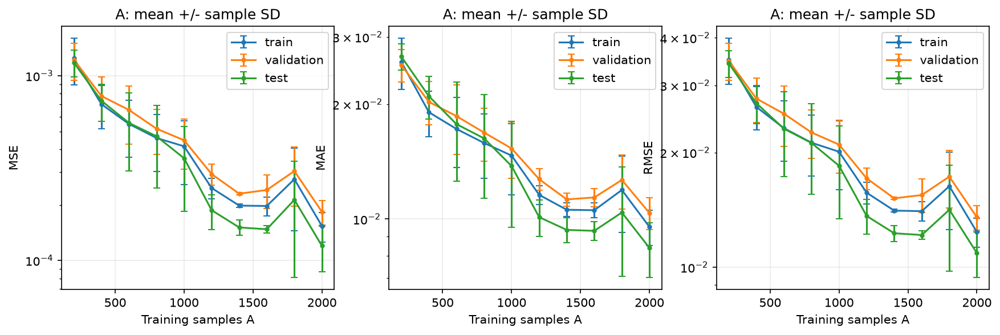
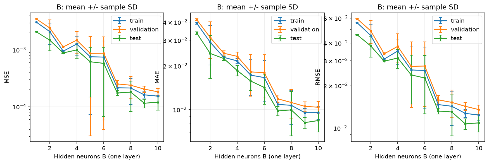
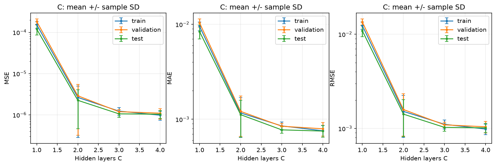
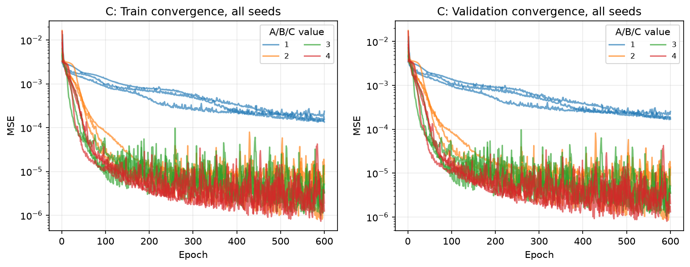
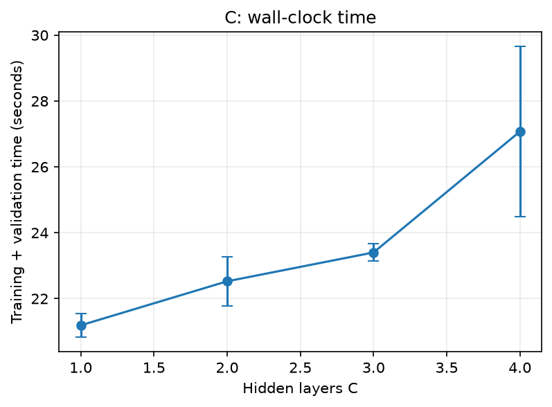
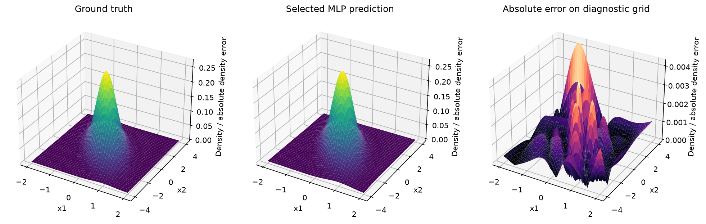
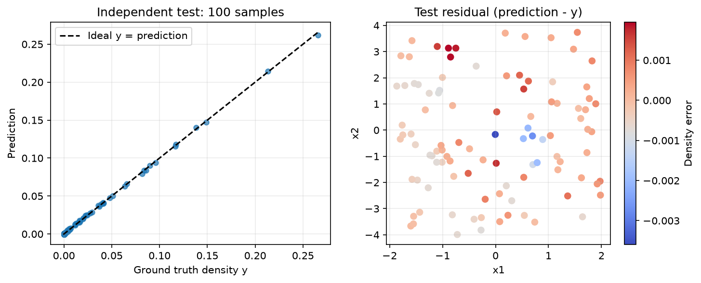

# IMPLEMENTATION REPORT – BTL01 Function Approximation

Ngày chạy UTC: 2026-11-03T06:59:57.983435+00:00 đến 2026-11-03T07:21:31.068021+00:00. Các giá trị bên dưới được đọc từ CSV của 72 lần chạy thật; không dùng kết quả mẫu.

## A. Requirement Analysis

Đã đọc toàn bộ 4 tài liệu: PDF chính thức 4 trang, MLP_Exercise 9 trang, Sample_Report 12 trang và nội dung notebook HTML. Bản trích xuất và SHA256 nằm tại `reports/source_materials/`. `MLP_Exercise - Yeu Cau.pdf` là nguồn yêu cầu cao nhất. Ma trận từng yêu cầu: [REQUIREMENT_TRACEABILITY.md](REQUIREMENT_TRACEABILITY.md).

PDF chính thức bổ sung validation độc lập, PyTorch, A/B/C có kiểm soát, logs/checkpoint, DOCX/PDF và PPTX. Các dải đề xuất được triển khai đầy đủ: A=200:200:2000, B=1..10, C=1..4. 3 seeds là khuyến khích và đã chạy. Báo cáo mẫu trang 2 in hệ số chuẩn hóa không đúng dạng 2D và code ví dụ dùng covariance identity, còn đề chính thức quy định covariance tương quan. Sample_Code dùng Keras và gọi MSE là “accuracy”; triển khai mới không kế thừa hai điểm này. Sample_Report dùng test làm validation; pipeline mới tách riêng.

Phương án: module Python nhỏ, CLI cấu hình JSON, train/validation riêng, checkpoint state_dict. Thông tin cá nhân/đóng góp được để trống theo chỉ dẫn người dùng. Không tự tạo danh tính hay tỷ lệ.

| Yêu cầu chính | Triển khai | Kết quả/bằng chứng |
| --- | --- | --- |
| Gaussian và dữ liệu độc lập | src/data.py | 3 CSV, 2000/400/100; tests analytic/shape/range/seed/independence |
| MLP/forward/backward | src/model.py; src/training.py | nn.Module/Linear; autograd; 72 runs CPU |
| Validation/checkpoint/early stop | src/training.py | 72 histories và best checkpoints; automated tests |
| A/B/C và fair comparison | configs/official.json; src/experiments.py | 30/30/12 runs; CSV/figures; seed mean±SD |
| Evaluation | src/metrics.py; src/visualization.py | MSE/MAE/RMSE; prediction parity; predicted/error surfaces |
| Kiểm chứng | tests; scripts/audit.py | 35 tests PASS; audit tái tính checkpoints và tables |
| Tài liệu/nộp bài | README; reports; slides; packaging | DOCX/PDF/PPTX; clean ZIP; danh tính để trống theo yêu cầu |
| Thuyết trình và CUDA | PRESENTATION_NOTES; device option | Demo notes sẵn có; thuyết trình trực tiếp/CUDA chưa thực hiện |

## B. Mathematical Foundation

Với x=(x1,x2)^T, μ=(0,0)^T, C=[[0.3,-0.5],[-0.5,2]],

`f(x) = exp(-0.5 * (x-μ)^T C^(-1) (x-μ)) / (2π sqrt(det(C)))`.

det(C)=0.35>0, C đối xứng xác định dương. C^(-1)=(1/0.35)[[2,0.5],[0.5,0.3]]. Hai trị riêng xấp xỉ 0.16385 và 2.13615; covariance âm làm đỉnh nghiêng theo hướng tương quan âm. μ xác định tâm; đường đồng mức phụ thuộc C. Giá trị cực đại tại μ là 1/(2π√0.35) ≈ 0.26902095. Đây là mật độ, không phải xác suất ở một điểm. Các x được lấy uniform trên hình chữ nhật, KHÔNG lấy mẫu x từ Gaussian; y=f(x).

Chuẩn hóa miền cố định: h0=x/[2,4]. Tầng l: zl=Wl h(l-1)+bl, hl=tanh(zl). Đầu ra: ŷ=Wout hC+bout (linear). Mỗi tầng có bias. Cấu hình một hidden layer B neurons có 4B+1 tham số; C tầng width B có 3B+(C-1)(B²+B)+B+1.

MSE=(1/N)Σ(ŷ-y)²; MAE=(1/N)Σ|ŷ-y|; RMSE=√MSE. Đơn vị MSE là mật độ bình phương, MAE/RMSE cùng đơn vị y. Đạo hàm đầu ra ∂L/∂ŷ=2(ŷ-y)/N. Với Tanh, ∂h/∂z=1-h²; quy tắc dây chuyền truyền gradient ngược qua các nn.Linear. `loss.backward()` tính gradient và Adam cập nhật trọng số bằng moment bậc nhất/bậc hai; không có gradient hoặc optimizer update trong validation/test.

## C. Implementation Walkthrough

| Module | Thành phần | Vai trò |
| --- | --- | --- |
| src/data.py | gaussian_2d, validate_data, generate_splits, save_csv, load_csv | Tính mật độ float64; kiểm SPD/finite/shape/range/nhãn; 3 RNG streams; CSV 17 chữ số. |
| src/model.py | MLP(nn.Module).forward | List hidden_sizes tùy chỉnh; tanh/relu/sigmoid; buffer input_scale; output linear. |
| src/training.py | seed_everything, make_loader, fit, validation_loss | Determinism; TensorDataset/DataLoader; vòng train và eval đúng ngữ cảnh. |
| src/training.py | predict, load_checkpoint | no_grad; batch inference; torch.load(weights_only=True); model.eval(). |
| src/metrics.py | regression_metrics | MSE/MAE/RMSE float64, từ chối broadcasting/NaN/empty. |
| src/experiments.py | experiment_specs, run, select_model, summarize | 24 cấu hình, 3 seeds, khóa selection trước test, sample SD ddof=1. |
| src/visualization.py | data_figures, comparison_figures, evaluation_figures | Agg backend; split labels, đơn vị, error bars; đóng figure sau save. |
| scripts/ | read_materials, build_deliverables, audit, package_submission | Nguồn, tài liệu, kiểm chứng độc lập và ZIP sạch. |

Luồng dữ liệu: uniform float64 → Gaussian labels → kiểm CSV → TensorDataset float32 → scale miền trong MLP → forward → MSELoss → zero_grad → backward → optimizer.step. Cuối epoch, model.eval()/no_grad() đánh giá lại toàn train và validation bằng tổng squared error chia N, kể cả batch cuối nhỏ. Train loss đo sau epoch khác optimization_loss là trung bình loss các batch lúc đang cập nhật.

Checkpoint theo validation minimum chính xác, clone tensor sang CPU để không bị trọng số cập nhật về sau làm thay đổi. min_delta chỉ phục vụ patience, không làm mất checkpoint có loss thấp hơn. Cuối fit luôn khôi phục best_state, không dùng mô hình cuối ngẫu nhiên. Checkpoint chứa state_dict, kiến trúc/config/seed, best_epoch và best_validation_loss; phục vụ inference, không hỗ trợ resume optimizer. Predict nhận đầu vào đơn vị gốc vì scale là buffer nằm trong checkpoint.

Train và validation được truyền vào fit; không có tham số test. Sau khi xong tất cả runs, chọn cấu hình theo validation MSE trung bình qua seeds, chọn seed đại diện theo validation nhỏ nhất, ghi selection.json và thời gian khóa; sau đó mới load test.csv để đánh giá. Biểu đồ grid là chẩn đoán hậu nghiệm, không thay test set 100 điểm, không dùng chọn hyperparameters.

## D. Experiment Design

Baseline: dữ liệu seed=2026; train pool=2000, validation=400, test=100; seeds khởi tạo/shuffle=11/29/47. Một hidden layer width=10; Tanh; output linear; Adam lr=0.01; batch=256; max epochs=600; patience=80; min_delta=1e-8; CPU 1 thread; num_workers=0. Cấu hình cụ thể ở `configs/official.json` và 72 JSON riêng.

| Nhóm | Biến thay đổi | Giữ cố định | Số runs |
| --- | --- | --- | --- |
| A | N=200,400,…,2000 | width10, depth1, toàn bộ training config và validation/test | 30 |
| B | B=1,…,10 | N2000, depth1, cùng train/validation/test và config | 30 |
| C | C=1,…,4 | N2000, width10/tầng, cùng dữ liệu/config | 12 |

A dùng prefix lồng nhau để giảm nhiễu lấy mẫu khi tăng N. Dữ liệu được giữ nguyên giữa ba model seeds, không phải ba dataset seeds. So sánh có paired seeds và cùng shuffle generator; kiến trúc khác không thể có toàn bộ trọng số khởi tạo giống nhau. A làm tăng số update/epoch; C làm tăng số parameters. Ngân sách cố định theo epoch không tương đương compute hoặc update budget cố định; thời gian wall-clock có nhiễu hệ thống. Các baseline A=2000/B=10/C=1 được chạy riêng và audit yêu cầu cùng seed cho prediction trùng.

## E. Experimental Results

Tất cả bảng lấy từ `results/tables/summary.csv`; mỗi ô test là mean ± sample SD trên 3 seeds. Mọi metric đo từ **best checkpoint**, đơn vị nhãn gốc. Không có ngưỡng MSE bắt buộc trong PDF và không giả định xu hướng đơn điệu.

### Nhóm A

| Giá trị | Train MSE mean | Validation MSE mean | Test MSE ± SD | Test MAE ± SD | Test RMSE ± SD |
| --- | --- | --- | --- | --- | --- |
| 200 | 1.242e-03 | 1.221e-03 | 1.178e-03 ± 1.943e-04 | 2.665e-02 ± 2.103e-03 | 3.425e-02 ± 2.778e-03 |
| 400 | 7.010e-04 | 7.759e-04 | 7.318e-04 ± 1.639e-04 | 2.098e-02 ± 2.705e-03 | 2.693e-02 ± 3.091e-03 |
| 600 | 5.481e-04 | 6.529e-04 | 5.553e-04 ± 2.502e-04 | 1.773e-02 ± 5.155e-03 | 2.308e-02 ± 5.806e-03 |
| 800 | 4.602e-04 | 5.166e-04 | 4.700e-04 ± 2.226e-04 | 1.628e-02 ± 4.949e-03 | 2.118e-02 ± 5.668e-03 |
| 1000 | 4.148e-04 | 4.472e-04 | 3.575e-04 ± 1.736e-04 | 1.377e-02 ± 4.257e-03 | 1.845e-02 ± 5.035e-03 |
| 1200 | 2.467e-04 | 2.934e-04 | 1.870e-04 ± 3.982e-05 | 1.012e-02 ± 1.099e-03 | 1.363e-02 ± 1.424e-03 |
| 1400 | 1.981e-04 | 2.299e-04 | 1.509e-04 ± 1.446e-05 | 9.367e-03 ± 7.040e-04 | 1.228e-02 ± 5.953e-04 |
| 1600 | 1.972e-04 | 2.407e-04 | 1.476e-04 ± 7.155e-06 | 9.314e-03 ± 5.365e-04 | 1.215e-02 ± 2.966e-04 |
| 1800 | 2.754e-04 | 3.047e-04 | 2.130e-04 ± 1.322e-04 | 1.040e-02 ± 3.315e-03 | 1.415e-02 ± 4.382e-03 |
| 2000 | 1.536e-04 | 1.834e-04 | 1.200e-04 ± 3.324e-05 | 8.403e-03 ± 1.378e-03 | 1.089e-02 ± 1.497e-03 |



Nhóm A: validation MSE trung bình thấp nhất ở giá trị 2000, validation MSE=1.834e-04; test MSE tại cấu hình này là 1.200e-04 ± 3.324e-05. Test MSE từ cấu hình đầu đến cuối: 1.178e-03 → 1.200e-04; có 8/9 bước liên tiếp giảm. Đây là mô tả hậu nghiệm, không dùng test để chọn mô hình. Với cùng 600 epochs tối đa, A=200 chỉ có 1 update/epoch còn A=2000 có 8; thời gian trung bình lần lượt 4.36s và 21.52s. Xu hướng chịu tác động đồng thời của lượng thông tin và số update; không suy luận thuần nhân quả từ đường test error.

### Nhóm B

| Giá trị | Train MSE mean | Validation MSE mean | Test MSE ± SD | Test MAE ± SD | Test RMSE ± SD |
| --- | --- | --- | --- | --- | --- |
| 1 | 3.087e-03 | 3.514e-03 | 2.087e-03 ± 1.428e-05 | 3.368e-02 ± 6.442e-04 | 4.569e-02 ± 1.561e-04 |
| 2 | 2.098e-03 | 2.434e-03 | 1.483e-03 ± 5.154e-04 | 2.434e-02 ± 8.005e-03 | 3.814e-02 ± 6.442e-03 |
| 3 | 9.478e-04 | 1.125e-03 | 8.847e-04 ± 2.295e-05 | 2.247e-02 ± 7.293e-04 | 2.974e-02 ± 3.851e-04 |
| 4 | 1.266e-03 | 1.483e-03 | 9.964e-04 ± 2.875e-04 | 1.857e-02 ± 1.522e-03 | 3.132e-02 ± 4.799e-03 |
| 5 | 7.567e-04 | 8.689e-04 | 6.183e-04 ± 4.711e-04 | 1.571e-02 ± 2.156e-03 | 2.377e-02 ± 8.940e-03 |
| 6 | 7.469e-04 | 8.727e-04 | 5.789e-04 ± 5.118e-04 | 1.420e-02 ± 3.336e-03 | 2.263e-02 ± 1.003e-02 |
| 7 | 2.156e-04 | 2.518e-04 | 1.743e-04 ± 1.671e-05 | 9.796e-03 ± 7.124e-04 | 1.319e-02 ± 6.255e-04 |
| 8 | 2.133e-04 | 2.388e-04 | 1.811e-04 ± 9.925e-05 | 9.949e-03 ± 3.361e-03 | 1.301e-02 ± 4.206e-03 |
| 9 | 1.619e-04 | 2.039e-04 | 1.153e-04 ± 1.968e-05 | 8.134e-03 ± 6.886e-04 | 1.071e-02 ± 9.417e-04 |
| 10 | 1.536e-04 | 1.834e-04 | 1.200e-04 ± 3.324e-05 | 8.403e-03 ± 1.378e-03 | 1.089e-02 ± 1.497e-03 |



Nhóm B: validation MSE trung bình thấp nhất ở giá trị 10, validation MSE=1.834e-04; test MSE tại cấu hình này là 1.200e-04 ± 3.324e-05. Test MSE từ cấu hình đầu đến cuối: 2.087e-03 → 1.200e-04; có 6/9 bước liên tiếp giảm. Đây là mô tả hậu nghiệm, không dùng test để chọn mô hình. B=1 tạo một ridge phi tuyến theo một tổ hợp tuyến tính của x; không đủ linh hoạt để biểu diễn đỉnh Gaussian 2D và nền ở nhiều phía. Train MSE B=1 là 3.087e-03, B=10 là 1.536e-04. Train/validation cùng cao phù hợp với thiếu khớp hoặc chưa tối ưu xong. Chênh lệch validation–train dương chưa đủ kết luận quá khớp nghiêm trọng; cần xem đường loss và biến động seed. Độ nhạy seed rõ nhất trong B ở width=5: validation MSE seed29=3.617e-04, seed11=1.836e-03, chênh 5.08 lần. Sự khác biệt dù cùng dữ liệu cho thấy vai trò của khởi tạo/shuffle và trạng thái tối ưu; không thể chỉ nhìn mean để kết luận tăng width luôn cải thiện. Tham chiếu chỉ dùng train: dự đoán hằng bằng mean y_train có MSE=3.083e-03; train MSE B=1 là 3.087e-03, gần mức hằng. Điều này củng cố nhận xét mô hình rất hẹp chưa học được cấu trúc đỉnh, nhưng không tách riêng hoàn toàn tác động capacity và tối ưu.

### Nhóm C

| Giá trị | Train MSE mean | Validation MSE mean | Test MSE ± SD | Test MAE ± SD | Test RMSE ± SD |
| --- | --- | --- | --- | --- | --- |
| 1 | 1.536e-04 | 1.834e-04 | 1.200e-04 ± 3.324e-05 | 8.403e-03 ± 1.378e-03 | 1.089e-02 ± 1.497e-03 |
| 2 | 2.646e-06 | 2.902e-06 | 2.253e-06 ± 1.788e-06 | 1.118e-03 ± 4.710e-04 | 1.419e-03 ± 5.983e-04 |
| 3 | 1.235e-06 | 1.196e-06 | 1.060e-06 ± 1.941e-07 | 7.735e-04 ± 6.242e-05 | 1.027e-03 ± 9.288e-05 |
| 4 | 9.812e-07 | 1.099e-06 | 1.039e-06 ± 2.300e-07 | 7.512e-04 ± 1.057e-04 | 1.015e-03 ± 1.147e-04 |



Nhóm C: validation MSE trung bình thấp nhất ở giá trị 4, validation MSE=1.099e-06; test MSE tại cấu hình này là 1.039e-06 ± 2.300e-07. Test MSE từ cấu hình đầu đến cuối: 1.200e-04 → 1.039e-06; có 3/3 bước liên tiếp giảm. Đây là mô tả hậu nghiệm, không dùng test để chọn mô hình. C=1 có 41 parameters; C=4 có 371. Thời gian trung bình 21.19s → 27.07s. Tăng độ sâu thay đổi cả độ biểu diễn lẫn số parameters và bài toán tối ưu. Không đo gradient theo layer nên không gán mọi thất bại cho vanishing gradient. Đường hội tụ và thời điểm checkpoint giúp phân biệt giới hạn ngân sách với khả năng biểu diễn.

### Hội tụ, thời gian và mô hình được chọn

Lựa chọn khóa trước test: C_0004_seed11, dựa trên validation MSE trung bình của cấu hình 1.099e-06. Seed đại diện có test MSE=7.965e-07, MAE=6.430e-04, RMSE=8.925e-04. Có 9/72 runs dừng sớm, 63/72 chạy tới 600 epochs. Chênh lệch validation–train MSE trung bình lớn nhất là 4.262e-04 tại B=1. Đây không phải kiểm định thống kê về overfitting; các seeds cùng dùng một tập dữ liệu và test nhỏ.

| C | Parameters | Thời gian mean ± SD (s) | Epochs mean | Best epoch mean |
| --- | --- | --- | --- | --- |
| 1 | 41 | 21.19 ± 0.36 | 600.0 | 596.0 |
| 2 | 151 | 22.53 ± 0.74 | 600.0 | 593.0 |
| 3 | 261 | 23.40 ± 0.26 | 600.0 | 582.7 |
| 4 | 371 | 27.07 ± 2.58 | 596.7 | 543.0 |









### Nhận xét từng cấu hình

| Nhóm | Giá trị | Quan sát từ logs |
| --- | --- | --- |
| A | 200 | Train 1.242e-03; validation 1.221e-03; gap -2.039e-05; best epoch trung bình 600.0; 4.36s. Loss train còn cao: xem khả năng biểu diễn/ngân sách tối ưu. |
| A | 400 | Train 7.010e-04; validation 7.759e-04; gap 7.492e-05; best epoch trung bình 598.3; 6.57s. Sai số train thấp hơn mốc tham chiếu mô tả 1e-3; không phải ngưỡng đạt của đề. |
| A | 600 | Train 5.481e-04; validation 6.529e-04; gap 1.048e-04; best epoch trung bình 593.3; 8.88s. Sai số train thấp hơn mốc tham chiếu mô tả 1e-3; không phải ngưỡng đạt của đề. |
| A | 800 | Train 4.602e-04; validation 5.166e-04; gap 5.638e-05; best epoch trung bình 590.0; 11.21s. Sai số train thấp hơn mốc tham chiếu mô tả 1e-3; không phải ngưỡng đạt của đề. |
| A | 1000 | Train 4.148e-04; validation 4.472e-04; gap 3.233e-05; best epoch trung bình 595.7; 12.12s. Sai số train thấp hơn mốc tham chiếu mô tả 1e-3; không phải ngưỡng đạt của đề. |
| A | 1200 | Train 2.467e-04; validation 2.934e-04; gap 4.670e-05; best epoch trung bình 593.7; 14.12s. Sai số train thấp hơn mốc tham chiếu mô tả 1e-3; không phải ngưỡng đạt của đề. |
| A | 1400 | Train 1.981e-04; validation 2.299e-04; gap 3.178e-05; best epoch trung bình 587.0; 16.12s. Sai số train thấp hơn mốc tham chiếu mô tả 1e-3; không phải ngưỡng đạt của đề. |
| A | 1600 | Train 1.972e-04; validation 2.407e-04; gap 4.351e-05; best epoch trung bình 598.0; 19.26s. Sai số train thấp hơn mốc tham chiếu mô tả 1e-3; không phải ngưỡng đạt của đề. |
| A | 1800 | Train 2.754e-04; validation 3.047e-04; gap 2.932e-05; best epoch trung bình 584.7; 20.49s. Sai số train thấp hơn mốc tham chiếu mô tả 1e-3; không phải ngưỡng đạt của đề. |
| A | 2000 | Train 1.536e-04; validation 1.834e-04; gap 2.978e-05; best epoch trung bình 596.0; 21.52s. Sai số train thấp hơn mốc tham chiếu mô tả 1e-3; không phải ngưỡng đạt của đề. |
| B | 1 | Train 3.087e-03; validation 3.514e-03; gap 4.262e-04; best epoch trung bình 117.7; 6.89s. Loss train còn cao: xem khả năng biểu diễn/ngân sách tối ưu. |
| B | 2 | Train 2.098e-03; validation 2.434e-03; gap 3.356e-04; best epoch trung bình 437.7; 17.45s. Loss train còn cao: xem khả năng biểu diễn/ngân sách tối ưu. |
| B | 3 | Train 9.478e-04; validation 1.125e-03; gap 1.776e-04; best epoch trung bình 593.7; 22.24s. Sai số train thấp hơn mốc tham chiếu mô tả 1e-3; không phải ngưỡng đạt của đề. |
| B | 4 | Train 1.266e-03; validation 1.483e-03; gap 2.165e-04; best epoch trung bình 553.3; 21.61s. Loss train còn cao: xem khả năng biểu diễn/ngân sách tối ưu. |
| B | 5 | Train 7.567e-04; validation 8.689e-04; gap 1.122e-04; best epoch trung bình 558.0; 21.89s. Sai số train thấp hơn mốc tham chiếu mô tả 1e-3; không phải ngưỡng đạt của đề. |
| B | 6 | Train 7.469e-04; validation 8.727e-04; gap 1.258e-04; best epoch trung bình 378.0; 15.82s. Sai số train thấp hơn mốc tham chiếu mô tả 1e-3; không phải ngưỡng đạt của đề. |
| B | 7 | Train 2.156e-04; validation 2.518e-04; gap 3.620e-05; best epoch trung bình 595.0; 21.96s. Sai số train thấp hơn mốc tham chiếu mô tả 1e-3; không phải ngưỡng đạt của đề. |
| B | 8 | Train 2.133e-04; validation 2.388e-04; gap 2.543e-05; best epoch trung bình 599.0; 21.95s. Sai số train thấp hơn mốc tham chiếu mô tả 1e-3; không phải ngưỡng đạt của đề. |
| B | 9 | Train 1.619e-04; validation 2.039e-04; gap 4.202e-05; best epoch trung bình 594.0; 21.90s. Sai số train thấp hơn mốc tham chiếu mô tả 1e-3; không phải ngưỡng đạt của đề. |
| B | 10 | Train 1.536e-04; validation 1.834e-04; gap 2.978e-05; best epoch trung bình 596.0; 21.58s. Sai số train thấp hơn mốc tham chiếu mô tả 1e-3; không phải ngưỡng đạt của đề. |
| C | 1 | Train 1.536e-04; validation 1.834e-04; gap 2.978e-05; best epoch trung bình 596.0; 21.19s. Sai số train thấp hơn mốc tham chiếu mô tả 1e-3; không phải ngưỡng đạt của đề. |
| C | 2 | Train 2.646e-06; validation 2.902e-06; gap 2.554e-07; best epoch trung bình 593.0; 22.53s. Sai số train thấp hơn mốc tham chiếu mô tả 1e-3; không phải ngưỡng đạt của đề. |
| C | 3 | Train 1.235e-06; validation 1.196e-06; gap -3.869e-08; best epoch trung bình 582.7; 23.40s. Sai số train thấp hơn mốc tham chiếu mô tả 1e-3; không phải ngưỡng đạt của đề. |
| C | 4 | Train 9.812e-07; validation 1.099e-06; gap 1.182e-07; best epoch trung bình 543.0; 27.07s. Sai số train thấp hơn mốc tham chiếu mô tả 1e-3; không phải ngưỡng đạt của đề. |

## F. Verification

**35 tests đã thực sự chạy, PASS**, không skip. Bằng chứng: `results/verification/pytest.xml` và `pytest_output.txt`. Bộ tests gồm Gaussian tâm/đối xứng/công thức quadratic/tích phân, SPD, dữ liệu shape/range/finite/nhãn và CSV roundtrip, 3 splits độc lập và seed, MLP các kiến trúc/activation, backward gradients, giảm validation loss, checkpoint save/load/best epoch, early stopping, metrics tính tay và từ chối broadcasting, train reproducibility, dải A/B/C/biến kiểm soát, selection không phụ thuộc test metrics.

Smoke đã chạy 6 runs riêng tại `results/smoke`, audit nạp lại 6 checkpoints và tái tính metrics PASS. Bộ chính thức chạy đủ 72 runs. `scripts/audit.py` độc lập nạp tất cả 72 checkpoint, tái tính train/validation/test metrics từ dữ liệu CSV, đối chiếu predictions và summary, xác minh best epoch=min history, configs và source hashes, test đúng100, không có điểm trùng splits, ba baseline cùng seed trùng prediction. Audit cuối được lưu sau khi xuất tài liệu vào `results/verification/audit.json`; chỉ file audit PASS mới xác nhận kết quả kiểm chứng đó.

Vấn đề môi trường và cách khắc phục: .venv cũ trỏ Python WindowsApps không khởi chạy; dùng Python 3.13.2 đã cài và venv .venv-run trong project, đọc lại PyTorch CPU sẵn có. pip trong sandbox bị WinError10013 do chặn mạng; đã cài dependencies cục bộ sau bước cấp quyền, không đổi cấu hình hệ thống. Lượt gọi unittest ban đầu gặp thiếu pytest khi dependencies còn tải; chuyển sang đúng pytest sau khi cài. Tests RED do các module chưa triển khai, rồi GREEN sau khi bổ sung; không coi lỗi import trước triển khai là bug huấn luyện. Không có kết quả PASS được suy đoán thay cho chạy thực tế.

Review độc lập không tìm thấy blocker ML, nhưng phát hiện audit có thể ưu tiên đường dẫn dữ liệu của checkout cũ và chưa đối chiếu run với toàn bộ config dự kiến. Đã sửa để ưu tiên CSV trong bản nộp hiện tại và kiểm params/spec của từng run; bổ sung 4 regression cases RED→GREEN. Đồng thời giảm font/spacing vùng text có hình trong PPTX để tránh chạm biểu đồ. Không đổi src hoặc siêu tham số trong lúc bộ chính thức đang train.

## G. Limitations & Future Improvements

- 100 test samples theo đề: sai số ước lượng có phương sai, không kết luận vượt trội thống kê chỉ từ mean±SD 3 seeds.
- 3 model seeds dùng cùng dữ liệu; chưa đo độ nhạy với seed dữ liệu, chưa có confidence interval theo sampling uncertainty.
- Cố định epoch thay vì update budget; số parameters thay đổi với width/depth; chưa có capacity-matched hoặc compute-matched comparison.
- Nhiều runs có thể chạm trần epoch; không dùng test để kéo dài hoặc tuning. Tanh có thể khó tối ưu; chưa đo gradient layer để khẳng định vanishing gradient.
- Output linear có thể âm ở đuôi; không clamp. Grid residual dùng để chẩn đoán, không tham gia chọn model.
- CPU được chạy thực tế; CUDA chưa kiểm chứng. Tính tái lập bitwise chỉ kiểm trong cùng môi trường, thời gian có nhiễu.
- DOCX/PPTX được xuất và kiểm cấu trúc; chưa render bằng Microsoft Word/PowerPoint trên máy này. Người dùng nên rà soát layout trong ứng dụng trước khi nộp. PDF báo cáo và PDF slide là bản xuất trực tiếp, không phải chuyển từ Office.
- Danh tính, MSSV, thành viên và đóng góp để trống theo yêu cầu; người dùng tự điền, đổi tên ZIP và thực hiện thuyết trình/hỏi đáp.

Hướng cải tiến: lặp nhiều data seeds; chạy thêm update-budget matched; khảo sát activation/LR/optimizer bằng validation với kế hoạch định trước; thử output softplus; phân tích residual theo vùng và bootstrap test uncertainty; kiểm CUDA độc lập. Đây là đề xuất tương lai, không phải kết quả đã chạy.

## H. Final Conclusion

Đã triển khai PyTorch đầy đủ các bước sinh dữ liệu → train/validation → checkpoint → lựa chọn validation → test cuối → bảng/hình/tài liệu; 24 cấu hình với 3 seeds, tổng 72 runs. Lựa chọn khóa trước test: C_0004_seed11, dựa trên validation MSE trung bình của cấu hình 1.099e-06. Seed đại diện có test MSE=7.965e-07, MAE=6.430e-04, RMSE=8.925e-04. Có 9/72 runs dừng sớm, 63/72 chạy tới 600 epochs. Chênh lệch validation–train MSE trung bình lớn nhất là 4.262e-04 tại B=1. Đây không phải kiểm định thống kê về overfitting; các seeds cùng dùng một tập dữ liệu và test nhỏ.

Các hạng mục kỹ thuật được truy vết tại RTM và audit. Phần chưa thực hiện trực tiếp gồm CUDA tùy chọn, render Office và thuyết trình ở lớp; thông tin cá nhân để trống theo chỉ dẫn. Không coi các phần đó là đã được kiểm chứng. Không có số liệu sample report được dùng làm kết quả thật.

### Lệnh đã chạy và cách tái lập

```powershell
.\.venv-run\Scripts\python.exe scripts/read_materials.py
.\.venv-run\Scripts\python.exe -m pytest -q --junitxml=results/verification/pytest.xml
.\.venv-run\Scripts\python.exe main.py --config configs/smoke.json --output results/smoke all
.\.venv-run\Scripts\python.exe scripts/audit.py --output results/smoke --no-documents
.\.venv-run\Scripts\python.exe main.py --config configs/official.json all
.\.venv-run\Scripts\python.exe scripts/build_deliverables.py
.\.venv-run\Scripts\python.exe scripts/audit.py
.\.venv-run\Scripts\python.exe scripts/package_submission.py
```

### Tài liệu tham khảo

1. MLP_Exercise - Yeu Cau.pdf, §§1–9, nguồn chính thức trong project.
2. MLP_Exercise.pdf, 9 trang, phát biểu và thiết kế A/B/C.
3. Sample_Code.html và Sample_Report.pdf: tham khảo cấu trúc, không dùng kết quả số.
4. [PyTorch: deterministic algorithms](https://docs.pytorch.org/docs/stable/generated/torch.use_deterministic_algorithms.html).
5. [PyTorch: Saving and Loading Models](https://docs.pytorch.org/tutorials/beginner/saving_loading_models).
6. [PyTorch: Reproducibility](https://docs.pytorch.org/docs/stable/notes/randomness.html).
